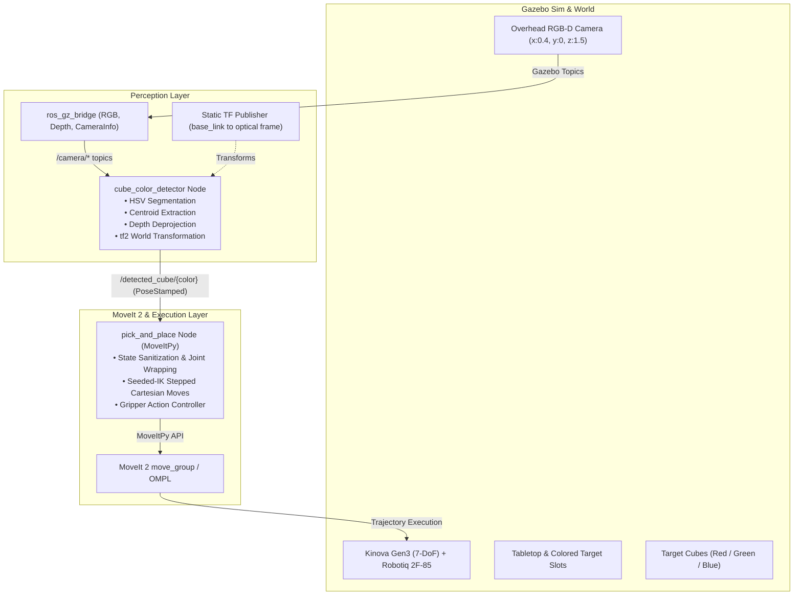

# Kinova Gen3 Autonomous Pick-and-Place with MoveIt 2 & Vision

An end-to-end autonomous vision-guided robotic pick-and-place and color-sorting system for a **7-DoF Kinova Gen3 manipulator** equipped with a **Robotiq 2F-85 adaptive gripper**, simulated in **ROS 2 Jazzy** and **Gazebo Sim**.

The system integrates overhead RGB-D depth perception, real-time HSV color segmentation, 3D coordinate transformation, and collision-aware motion planning via **MoveIt 2 (MoveItPy)** using seeded-IK stepped Cartesian trajectories.

---

## Table of Contents

- [Project Overview](#project-overview)
  - [System Architecture](#system-architecture)
  - [Key Features](#key-features)
- [Repository Structure](#repository-structure)
- [Prerequisites & System Requirements](#prerequisites--system-requirements)
- [Installation & Build](#installation--build)
- [Usage Guide](#usage-guide)
  - [Option 1: All-in-One Autonomous Random Cube Pick-and-Place (Quick Start)](#option-1-all-in-one-autonomous-random-cube-pick-and-place-quick-start)
  - [Option 2: Multi-Cube Color Sorting Demo](#option-2-multi-cube-color-sorting-demo)
  - [Option 3: Modular / Manual Multi-Terminal Workflow](#option-3-modular--manual-multi-terminal-workflow)
  - [Option 4: Standalone Testing & Diagnostic Scripts](#option-4-standalone-testing--diagnostic-scripts)
- [Technical Pipeline & Architecture](#technical-pipeline--architecture)
  - [Perception Pipeline](#perception-pipeline)
  - [Motion Planning & Cartesian Control](#motion-planning--cartesian-control)
  - [Joint Wrapping & State Sanitization](#joint-wrapping--state-sanitization)
- [Troubleshooting & Tips](#troubleshooting--tips)

---

## Project Overview

This repository provides nodes, launch files, configurations, and SDF simulation models to execute autonomous pick-and-place operations on colored cubes (Red, Green, Blue) placed on a tabletop in Gazebo.

### System Architecture



### Key Features

- **RGB-D Vision Perception**: Overhead camera captures synced RGB and depth streams. HSV color thresholding segments Red, Green, and Blue cubes; centroids are deprojected to 3D camera coordinates and transformed into the robot's `base_link` frame via `tf2`.
- **Seeded-IK Stepped Cartesian Trajectories**: Descents, lifts, and fine horizontal transfers are divided into small, fine Cartesian increments ($15\text{ mm}$ steps) solved with inverse kinematics seeded from the live arm state to maintain branch continuity and avoid unpredictable elbow reconfigurations.
- **Start State Sanitization**:
  - Wraps continuous joints (`joint_1`, `joint_3`, `joint_5`, `joint_7`) into $[-\pi, \pi]$ to avoid spurious multi-turn wraps.
  - Clamps non-continuous joint limits (`joint_6`, `joint_3`) with a safety margin to prevent controller jitter and floating-point overshoot from triggering MoveIt's `CheckStartStateBounds` planning failures.
- **Autonomous Sorting**: Identifies cube colors and automatically routes them to corresponding desaturated color target markers on the table surface.
- **Randomized Simulation Testing**: Includes launch configurations that spawn cubes at randomized coordinates and colors across the table surface to stress-test detection and reachability.

---

## Repository Structure

```
kinova_scripts/
├── CMakeLists.txt / setup.py     # Python package setup and data file installations
├── package.xml                   # ROS 2 package dependencies
├── README.md                     # Documentation
├── config/
│   ├── camera_bridge.yaml        # ros_gz_bridge topic mapping (RGB, depth, camera_info)
│   └── moveit_cpp.yaml           # MoveItPy OMPL pipeline & trajectory execution tolerances
├── kinova_scripts/
│   ├── cube_color_detector.py    # Vision node: HSV mask, depth deprojection, tf2 transform
│   ├── pick_and_place_demo.py    # Multi-cube sequential color-sorting pick-and-place
│   ├── pick_and_place_single.py  # Single-cube pick-and-place with marker rejection logic
│   ├── grasp_isolation_test.py   # Standalone Cartesian descent & grasp test
│   ├── pose_goal_demo.py         # MoveItPy Cartesian pose goal demo with joint wrapping
│   ├── pose_gripper_demo.py      # MoveItPy Robotiq gripper open/close demo
│   └── spawn_cube_collision.py   # Adds collision box to MoveIt planning scene
├── launch/
│   ├── full_sim_random_cube_pick.launch.py # All-in-one end-to-end autonomous simulation
│   ├── full_sim_random_cube.launch.py      # Simulation staging with one random cube
│   ├── full_sim.launch.py                  # Simulation staging with 3 fixed cubes (R/G/B)
│   ├── pick_and_place_demo.launch.py       # Launches multi-cube pick-and-place node
│   ├── grasp_isolation_test.launch.py      # Launches standalone grasp isolation test
│   ├── pose_goal_demo.launch.py            # Launches pose goal demo node
│   └── gripper_demo.launch.py              # Launches gripper test node
└── models/
    ├── overhead_camera/          # SDF model for RGB-D camera sensor
    ├── simple_table/             # SDF table model with color-coded target slots
    ├── simple_cube/              # 4cm Red cube SDF model
    ├── simple_cube_green/        # 4cm Green cube SDF model
    └── simple_cube_blue/         # 4cm Blue cube SDF model
```

---

## Prerequisites & System Requirements

- **Operating System**: Ubuntu 24.04 LTS (Noble) / Ubuntu 22.04 LTS (Jammy)
- **ROS 2 Distribution**: ROS 2 Jazzy Jalisco (or Iron / Humble with corresponding Gazebo version)
- **Simulator**: Gazebo Sim (Harmonic / `ros_gz`)
- **Required ROS 2 Packages**:
  - `moveit_py`, `moveit_configs_utils`, `moveit_ros_planning_interface`
  - `kortex_bringup` (Kinova Kortex ROS 2 driver/simulation)
  - `kinova_gen3_7dof_robotiq_2f_85_moveit_config`
  - `ros_gz_sim`, `ros_gz_bridge`
  - `cv_bridge`, `sensor_msgs`, `geometry_msgs`, `tf2_ros`, `tf2_geometry_msgs`
- **Python Libraries**:
  - `opencv-python` (`python3-opencv`)
  - `numpy`

---

## Installation & Build

1. **Set up workspace**:
   ```bash
   mkdir -p ~/kinova_ws/src
   cd ~/kinova_ws/src
   ```

2. **Clone the repository**:
   ```bash
   git clone git@github.com:MadheshBS/Kinova_scripts.git kinova_scripts
   ```

3. **Install dependencies**:
   ```bash
   cd ~/kinova_ws
   rosdep update
   rosdep install --from-paths src --ignore-src -r -y
   ```

4. **Build the package**:
   ```bash
   colcon build --packages-select kinova_scripts
   source install/setup.bash
   ```

> [!TIP]
> Remember to source `~/kinova_ws/install/setup.bash` in each new terminal or append it to your `~/.bashrc`.

---

## Usage Guide

### Option 1: All-in-One Autonomous Random Cube Pick-and-Place (Quick Start)

The easiest way to run the entire system is with the staged autonomous launch file. It automatically:
1. Spawns the Kinova Gen3 7-DoF robot with Robotiq 2F-85 gripper in Gazebo.
2. Initializes MoveIt 2 `move_group` and RViz.
3. Spawns the table and overhead camera.
4. Starts the camera parameter bridge and publishes the static transform.
5. Randomly selects a cube color (Red, Green, or Blue) and spawns it at random table coordinates $(x \in [0.30, 0.48], y \in [-0.20, 0.20])$.
6. Launches `cube_color_detector` to locate the cube.
7. Executes `pick_and_place_single` to pick the detected cube and sort it onto its designated table marker slot.

```bash
ros2 launch kinova_scripts full_sim_random_cube_pick.launch.py
```

---

### Option 2: Multi-Cube Color Sorting Demo

To run the full sorting demonstration with all three cubes (Red, Green, and Blue) present on the table:

**Terminal 1 — Launch the complete simulation environment**:
```bash
ros2 launch kinova_scripts full_sim.launch.py
```
*This starts Gazebo, MoveIt 2, RViz, table, camera bridge, static TF, spawns all three cubes, and starts the color detector.*

**Terminal 2 — Run the multi-cube pick-and-place sequencer**:
```bash
ros2 launch kinova_scripts pick_and_place_demo.launch.py
```
*The robot will sequentially locate Red, Green, and Blue cubes, grasp each one, transfer it across the table, place it onto its assigned colored slot, and return home.*

---

### Option 3: Modular / Manual Multi-Terminal Workflow

For fine-grained debugging, camera inspection, or developing individual components, run each stage in separate terminals:

| Terminal | Purpose | Command |
| :--- | :--- | :--- |
| **1. Gazebo Robot** | Spawns Kinova Gen3 in Gazebo | `ros2 launch kortex_bringup kortex_sim_control.launch.py robot_type:=gen3 dof:=7 gripper:=robotiq_2f_85` |
| **2. MoveIt MoveGroup** | MoveIt 2 motion planning server | `ros2 launch kinova_gen3_7dof_robotiq_2f_85_moveit_config move_group.launch.py` |
| **3. MoveIt RViz** | Visualization GUI | `ros2 launch kinova_gen3_7dof_robotiq_2f_85_moveit_config moveit_rviz.launch.py` |
| **4. Spawn Table** | Spawns the tabletop in Gazebo | `ros2 run ros_gz_sim create -file ~/kinova_ws/src/kinova_scripts/models/simple_table/model.sdf -name my_table -x 0.4 -y 0.0 -z 0.2` |
| **5. Overhead Camera** | Spawns camera & starts bridge | `ros2 run ros_gz_sim create -file ~/kinova_ws/src/kinova_scripts/models/overhead_camera/model.sdf -name overhead_camera -x 0.4 -y 0.0 -z 1.5 -R 0 -P 1.5708 -Y 0`<br>`ros2 run ros_gz_bridge parameter_bridge --ros-args -p config_file:=$HOME/kinova_ws/src/kinova_scripts/config/camera_bridge.yaml` |
| **6. Static TF** | Camera to `base_link` transform | `ros2 run tf2_ros static_transform_publisher --x 0.4 --y 0.0 --z 1.5 --qx 0.7071 --qy -0.7071 --qz 0 --qw 0 --frame-id base_link --child-frame-id overhead_camera/camera_link/overhead_rgbd` |
| **7. Spawn Cubes** | Spawns Red, Green, and Blue cubes | `ros2 run ros_gz_sim create -file ~/kinova_ws/src/kinova_scripts/models/simple_cube/model.sdf -name cube_red -x 0.4 -y 0.1 -z 0.42`<br>`ros2 run ros_gz_sim create -file ~/kinova_ws/src/kinova_scripts/models/simple_cube_green/model.sdf -name cube_green -x 0.4 -y 0.0 -z 0.42`<br>`ros2 run ros_gz_sim create -file ~/kinova_ws/src/kinova_scripts/models/simple_cube_blue/model.sdf -name cube_blue -x 0.4 -y -0.1 -z 0.42` |
| **8. Color Detector** | Starts OpenCV perception node | `ros2 run kinova_scripts cube_color_detector` |
| **9. Pick & Place** | Executes pick-and-place sequence | `ros2 launch kinova_scripts pick_and_place_demo.launch.py` |

---

### Option 4: Standalone Testing & Diagnostic Scripts

#### 1. Gripper Action Test
Test opening and closing the Robotiq 2F-85 gripper via MoveItPy:
```bash
ros2 launch kinova_scripts gripper_demo.launch.py
```

#### 2. Arm Cartesian Pose Goal Demo
Test planning to a fixed end-effector pose with joint angle wrapping:
```bash
ros2 launch kinova_scripts pose_goal_demo.launch.py
```

#### 3. Grasp Isolation Test
Validates stepped Cartesian descent and physical gripper contact without perception:
```bash
ros2 launch kinova_scripts grasp_isolation_test.launch.py
```

#### 4. RViz Collision Scene Cube
Injects a collision box into MoveIt's planning scene corresponding to the target cube:
```bash
ros2 run kinova_scripts spawn_cube_collision
```

#### 5. Camera & Topic Inspection Tools
- **View live camera feed**:
  ```bash
  QT_QPA_PLATFORM=xcb ros2 run rqt_image_view rqt_image_view
  ```
- **Echo detected cube poses (in `base_link` coordinates)**:
  ```bash
  ros2 topic echo /detected_cube/red
  ros2 topic echo /detected_cube/green
  ros2 topic echo /detected_cube/blue
  ```
- **Inspect camera intrinsics**:
  ```bash
  ros2 topic echo /camera/camera_info --once
  ```

---

## Technical Pipeline & Architecture

### Perception Pipeline

1. **Sensor Setup**:
   The overhead camera is located at $(x=0.4, y=0.0, z=1.5)$ pointing straight down ($\text{Pitch} = \pi/2$). The static transformation to `base_link` is:
   - Translation: `(0.4, 0.0, 1.5)`
   - Rotation (quaternion): `(0.7071, -0.7071, 0.0, 0.0)`
2. **HSV Thresholding**:
   - **Red**: Split range to handle hue wrap: $[0, 100, 100] \to [10, 255, 255]$ and $[170, 100, 100] \to [179, 255, 255]$.
   - **Green**: $[45, 100, 100] \to [75, 255, 255]$.
   - **Blue**: $[105, 100, 100] \to [135, 255, 255]$.
   - Table slot markers are desaturated in the SDF (`S < 100`) so they are ignored by the thresholding masks.
3. **Pinhole Deprojection**:
   Given contour centroid $(u, v)$ and registered depth $Z$:
   $$X_{\text{camera}} = \frac{(u - c_x) \cdot Z}{f_x}, \quad Y_{\text{camera}} = \frac{(v - c_y) \cdot Z}{f_y}, \quad Z_{\text{camera}} = Z$$
4. **Coordinate Transformation**:
   The 3D point is transformed from `overhead_camera/camera_link/overhead_rgbd` into `base_link` using `tf2_ros` and published on `/detected_cube/<color>`.

### Motion Planning & Cartesian Control

- **End-Effector Orientation**: Pinned vertically pointing straight down (`qx=1.0, qy=0.0, qz=0.0, qw=0.0`).
- **Calibrated Z-Heights**:
  - Pre-grasp height: $Z = 0.38\text{ m}$
  - Grasp contact height: $Z = 0.28\text{ m}$
- **Seeded-IK Stepped Moves**:
  Rather than requesting large end-to-end Cartesian trajectories, vertical descent/lift and horizontal transfers are divided into discrete sub-steps ($\Delta \le 15\text{ mm}$ for descent, $30\text{ mm}$ for transfer). For each step, Inverse Kinematics is solved using the current robot joint state as the seed. The resulting joint configuration is commanded as a joint-space goal, preventing MoveIt from selecting alternative kinematic branches.

### Joint Wrapping & State Sanitization

Simulated execution and floating-point jitter can lead to planning failures if joints drift slightly beyond bounds. The nodes implement:
- **Continuous Joint Wrapping**: Joints 1, 3, 5, and 7 are continuous. Their values are wrapped into $[-\pi, \pi]$ using `(angle + pi) % (2 * pi) - pi`.
- **Hard Joint Limit Clamping**:
  - `joint_6` limit: $[-2.09, 2.09]\text{ rad}$
  - `joint_3` limit: $[-\pi, \pi]\text{ rad}$
  Values outside bounds by even $10^{-5}\text{ rad}$ are clamped slightly inside the limits ($\pm 0.001\text{ rad}$) before passing the start state to MoveIt, preventing `CheckStartStateBounds` failures.

---

## Troubleshooting & Tips

- **Duplicate Bridge / Camera Processes**:
  If the detector outputs noisy or frozen coordinates, check for duplicate camera or bridge processes:
  ```bash
  ps aux | grep -E "overhead_camera|parameter_bridge" | grep -v grep
  ```
  Kill any stale instances before launching.
- **Trajectory Execution Timeout**:
  If stepped Cartesian moves fail with execution timeouts during simulation slowdowns, adjust `allowed_execution_duration_scaling` and `allowed_goal_duration_margin` in `config/moveit_cpp.yaml`.
- **RViz Display Issues on Linux**:
  If RViz or `rqt_image_view` crashes or displays a black window on Wayland / multi-GPU setups, prepend `QT_QPA_PLATFORM=xcb`:
  ```bash
  QT_QPA_PLATFORM=xcb ros2 run rqt_image_view rqt_image_view
  ```

---

## License

This project is licensed under the Apache 2.0 License.
