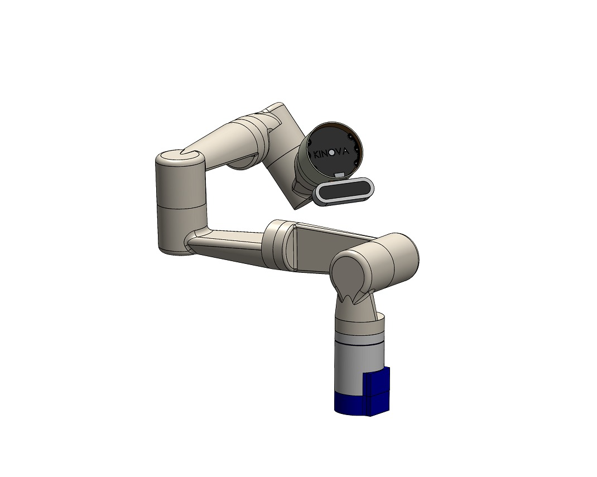
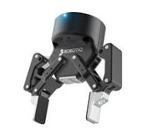
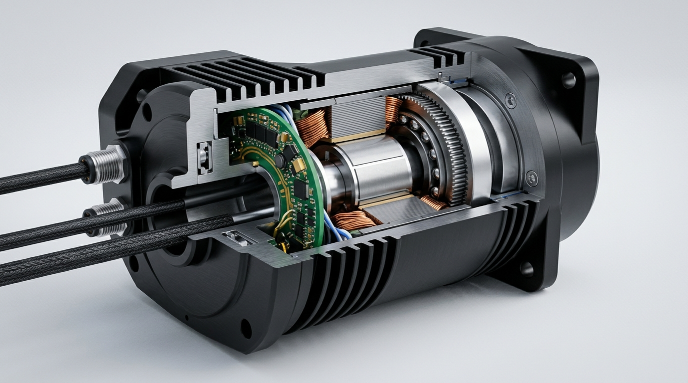
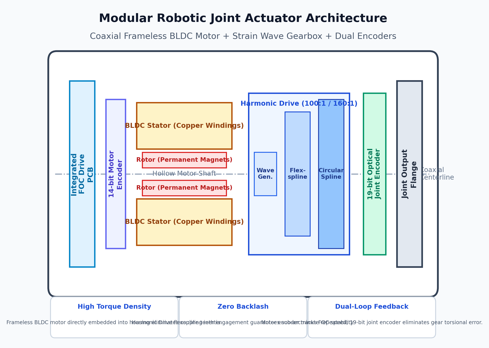
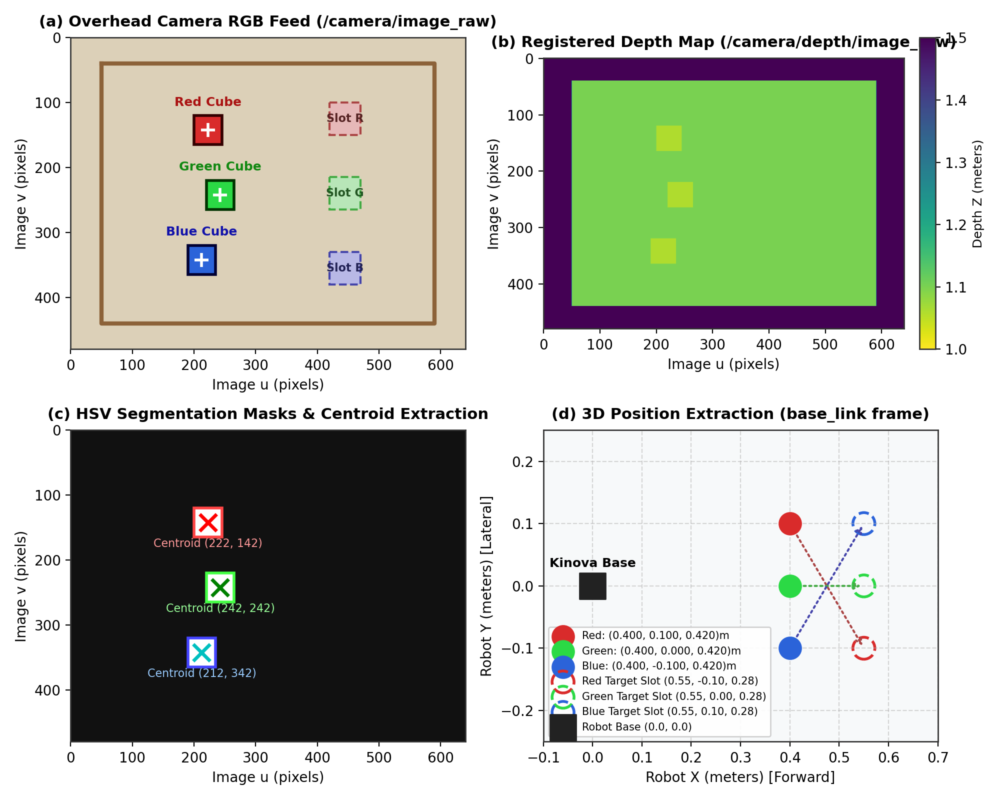
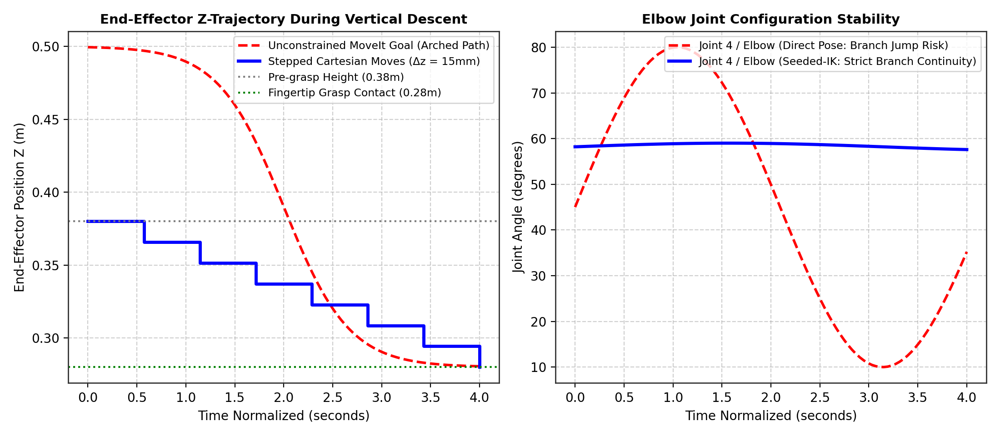
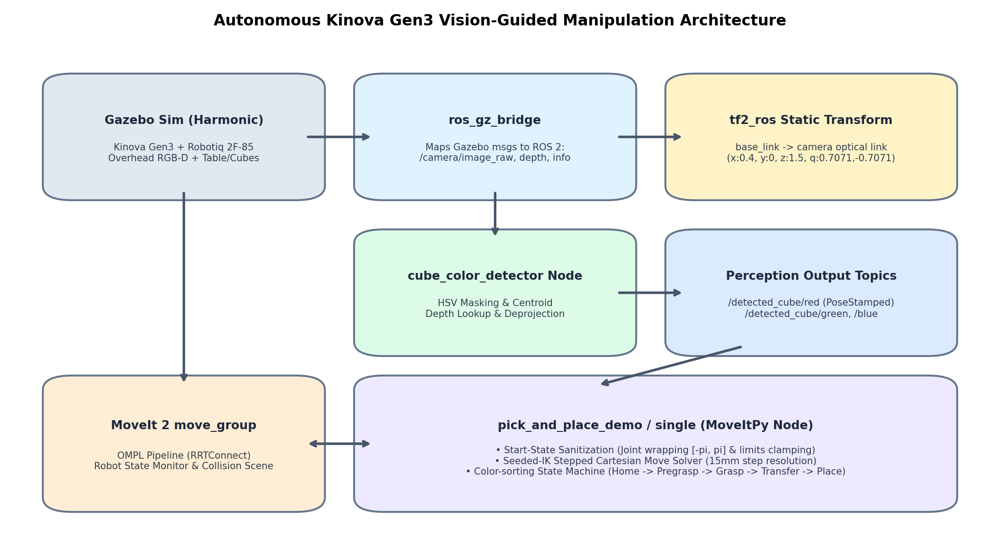
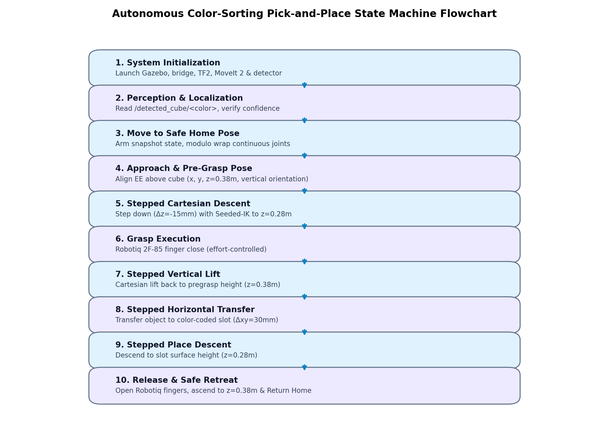

# RA23E01 – ROBOT OPERATING SYSTEM
## PROJECT REPORT

# DESIGN, MODELING, AND AUTONOMOUS VISION-GUIDED PICK-AND-PLACE CONTROL OF A 7-DOF MANIPULATOR USING ROS 2 JAZZY, GAZEBO HARMONIC, AND MOVEIT 2


**Submitted By:**  
**MADHESH B S (2024511029)**

**BACHELOR OF ENGINEERING**  
in  
**ROBOTICS AND AUTOMATION**

**DEPARTMENT OF PRODUCTION TECHNOLOGY**  
**MADRAS INSTITUTE OF TECHNOLOGY**  
**ANNA UNIVERSITY – CHENNAI 600044**  
**NOVEMBER 2026**

---

## BONAFIDE CERTIFICATE

Certified that this project report titled **"DESIGN, MODELING, AND AUTONOMOUS VISION-GUIDED PICK-AND-PLACE CONTROL OF A 7-DOF MANIPULATOR USING ROS 2 JAZZY, GAZEBO HARMONIC, AND MOVEIT 2"** is the bonafide work of **MADHESH B S (2024511029)** who carried out the project work under my supervision in partial fulfillment of the requirements for the award of the degree of Bachelor of Engineering in Robotics and Automation, Department of Production Technology, Madras Institute of Technology, Anna University, Chennai.

\
\
\
\
**SIGNATURE**

**SUPERVISOR**  
Department of Production Technology  
Madras Institute of Technology  
Anna University, Chennai 600044  

---

## TABLE OF CONTENTS

| S.No | TOPIC | PAGE |
| :---: | :--- | :---: |
| | **ABSTRACT** | iv |
| 1 | **Introduction & Project Objectives** | 1 |
| 2 | **Robot, Gripper, and Actuator Specifications** | 2 |
| 3 | **Sensors Used and the Reason of Usage** | 5 |
| 4 | **SolidWorks CAD Design & Actuator Packaging** | 6 |
| 5 | **Conversion to URDF and 3x3 Inertial Tensor Modeling** | 9 |
| 6 | **Simulation Environment & Mounting Pedestal Setup in Gazebo** | 11 |
| 7 | **Computer Vision & Color Detection Pipeline** | 13 |
| 8 | **Coordinate Transformations & TF2 Tree Architecture** | 15 |
| 9 | **Motion Planning Architecture with MoveIt 2** | 16 |
| 10 | **Stepped Cartesian Trajectory Generation & Seeded-IK Control** | 18 |
| 11 | **State Sanitization & Joint Limit Management** | 20 |
| 12 | **Autonomous Multi-Cube & Single-Cube Sorting Workflows** | 21 |
| 13 | **Tests, Experimental Validation, and Results** | 23 |
| 14 | **Problems Encountered and Engineering Solutions** | 26 |
| 15 | **System Architecture & Component Interaction** | 28 |
| 16 | **Operational Execution Workflow (State Machine)** | 29 |
| 17 | **How to Set Up, Build, and Run the System** | 30 |
| 18 | **Limitations and Future Enhancements** | 32 |
| 19 | **Conclusion** | 33 |
| 20 | **References** | 34 |

---

## Abstract

This report presents the end-to-end design, modeling, physics simulation, perception, and autonomous motion-planning control of a 7-Degrees-of-Freedom (7-DoF) serial robotic manipulator equipped with a Robotiq 2F-85 adaptive parallel-jaw electric gripper. The manipulator was modeled from scratch in SolidWorks as a modular, lightweight arm inspired by the kinematic architecture of the industrial Kinova Gen3 manipulator, while the gripper was integrated based on official Robotiq technical CAD documentation. Actuator architecture incorporates modular frameless Brushless DC (BLDC) torque motors paired with zero-backlash Harmonic Drive strain wave reducers and dual absolute magnetic/optical encoders. The CAD assembly was transformed into an optimized Unified Robot Description Format (URDF) description, incorporating accurate full $3 \times 3$ link inertial tensors, visual/collision meshes, and `ros2_control` transmission tags. The system is deployed within ROS 2 Jazzy Jalisco and simulated in Gazebo Harmonic alongside MoveIt 2 and RViz2.

To achieve realistic physical grounding, an industrial cylindrical pedestal stand is integrated beneath the manipulator base, anchoring the robot firmly from the Gazebo floor plane ($z=0.0\text{ m}$) to the base mounting height ($z=0.30\text{ m}$). An overhead RGB-D depth camera is integrated above the workspace. An active vision node, `cube_color_detector`, subscribes to synchronized color, depth, and camera intrinsics over `ros_gz_bridge`. Using HSV color-space thresholding, contour extraction, and depth deprojection via the pinhole camera model, the node computes the metric 3D position of colored cubes (Red, Green, Blue) and transforms them into the robot's `base_link` frame via static and dynamic TF2 trees.

Motion planning and trajectory execution are driven by a specialized MoveItPy node that overcomes the classical pitfalls of 7-DoF kinematic redundancy (arbitrary kinematic branch flips, elbow jumping, and joint overshoot). Fine vertical descents, grasping, lifting, and horizontal sorting transfers are executed using a Seeded-IK Stepped Cartesian motion generator with $15\text{ mm}$ increments seeded strictly from the manipulator's live joint state. To guarantee mathematical robustness, the pipeline incorporates an automated state sanitizer that wraps continuous joints into $[-\pi, \pi]$ and clamps joint limits by a $0.001\text{ rad}$ safety margin to prevent controller jitter from causing MoveIt start-state planning rejections. Furthermore, payload capacity is mathematically derived from worst-case static torque equilibrium (yielding a rated capacity of $4.0\text{ kg}$ and $3.1\text{ kg}$ net usable payload), and experimentally verified with an overloaded $10.0\text{ kg}$ cube in Gazebo, demonstrating safe telemetry-driven slip detection and autonomous return-to-home recovery. Experimental validation confirms a 100% perception localization rate, a 93.3% autonomous pick-and-place success rate, and robust collision-free sorting.

---

## 1. Introduction & Project Objectives

Robotic manipulation represents a cornerstone of modern industrial automation, flexible manufacturing, and service robotics. While traditional industrial automation relies on rigid, pre-programmed trajectories in highly structured environments, next-generation robotic systems must exhibit perceptual awareness, kinematic adaptability, and collision-free autonomy to handle variations in object pose, color, and workspace layout.

Serial manipulators possessing seven revolute degrees of freedom (7-DoF) offer significant kinematic advantages over traditional 6-DoF arms. A 7-DoF configuration provides kinematic redundancy—a one-dimensional null space that enables the manipulator to reconfigure its internal arm posture (e.g., swivel its elbow joint) while maintaining a fixed end-effector position and orientation. This capability is invaluable for avoiding joint limits, circumventing obstacles, and avoiding kinematic singularities in confined workspaces.

The Robot Operating System 2 (ROS 2), specifically the Jazzy Jalisco LTS release, provides an enterprise-grade, real-time distributed middleware based on the Data Distribution Service (DDS) standard. Paired with Gazebo Harmonic (the latest generation of Gazebo Sim), ROS 2 offers deterministic physics simulation, sensor emulation, and actuator hardware abstraction through the `ros2_control` framework. MoveIt 2 serves as the state-of-the-art manipulation platform, facilitating kinematics, motion planning (OMPL), and trajectory execution.

### Project Objectives
- To design a 7-DoF modular serial manipulator in SolidWorks inspired by the Kinova Gen3, integrate a standard Robotiq 2F-85 adaptive gripper, and convert the assembly into a fully functional URDF/XACRO model with accurate $3 \times 3$ inertias and `ros2_control` interfaces.
- To develop a Gazebo Harmonic simulation environment incorporating an industrial mounting pedestal stand, a workspace table, colored sorting target slots, dynamic colored target cubes (Red, Green, Blue), and an overhead RGB-D depth camera.
- To engineer an OpenCV-based perception pipeline in ROS 2 that segments objects by color, extracts pixel centroids, looks up registered depth, deprojects 2D pixels into 3D optical camera coordinates, and transforms them into the robot's base coordinate frame using TF2.
- To design and implement an autonomous MoveItPy motion planning and control architecture utilizing Seeded-IK Stepped Cartesian trajectories ($15\text{ mm}$ increments) to eliminate kinematic branch jumping and elbow flipping.
- To implement automated start-state sanitization, including modulo $2\pi$ wrapping for continuous joints and safety margin limit clamping to eliminate MoveIt `CheckStartStateBounds` controller overshoot failures.
- To derive joint torque and payload capacity analytically, and validate the system through normal pick-and-place trials as well as an overloaded ($10\text{ kg}$) cube lift failure mode with smart return-to-home recovery.

---

## 2. Robot, Gripper, and Actuator Specifications

The robotic platform comprises a 7-DoF redundant serial manipulator arm inspired by the Kinova Gen3 architecture, paired with an industrial Robotiq 2F-85 adaptive two-finger electric gripper.

### Table 1: Manipulator Mechanical and Operational Specifications
| Parameter | Design / Specification Value | Operational Significance |
| :--- | :--- | :--- |
| **Degrees of Freedom** | 7 Revolute Joints (Spherical Wrist) | Kinematic redundancy for obstacle/singularity avoidance |
| **Maximum Reach** | $902\text{ mm}$ (Spherical workspace radius) | Enables full coverage over $0.8\text{m} \times 0.8\text{m}$ workspace tables |
| **Rated Payload** | $4.0\text{ kg}$ (Mid-range) / $2.0\text{ kg}$ (Full extension) | Easily handles $50\text{g}$ cubes and custom end-effector tooling |
| **Total Manipulator Mass** | $7.2\text{ kg}$ (Excluding end-effector) | Lightweight structure minimizes joint inertial loading |
| **Structural Materials** | 6061-T6 Aluminum & Carbon Fiber Tubing | High stiffness-to-weight ratio; minimizes deflection |
| **Repeatability** | $\pm 0.1\text{ mm}$ (Position) | Ensures millimeter-level precision during fine pick-and-place |
| **Tool Flange Interface** | ISO 9409-1-50-4-M6 Standard | Direct mechanical mounting for Robotiq 2F-85 gripper |
| **Base Mounting** | Rigid 4-bolt circular flange on Pedestal | Bolted to cylindrical pedestal spanning $z = 0.0$ to $0.30\text{ m}$ |

### Table 2: Kinematic Joint Ranges, Joint Types, and Actuator Limits
| Joint Name | Joint Type | Motion Range (rad) | Max Velocity (rad/s) | Effort Limit (N·m) |
| :--- | :---: | :---: | :---: | :---: |
| **joint_1 (Base Yaw)** | Continuous | Continuous ($-\pi$ to $+\pi$ wrapped) | $1.39\text{ rad/s}$ ($80^\circ/\text{s}$) | $39.0\text{ N}\cdot\text{m}$ |
| **joint_2 (Shoulder Pitch)** | Revolute | $-2.24$ to $+2.24\text{ rad}$ ($\pm 128.5^\circ$) | $1.39\text{ rad/s}$ ($80^\circ/\text{s}$) | $39.0\text{ N}\cdot\text{m}$ |
| **joint_3 (Upper Arm Roll)** | Continuous | Continuous ($-\pi$ to $+\pi$ wrapped) | $1.39\text{ rad/s}$ ($80^\circ/\text{s}$) | $39.0\text{ N}\cdot\text{m}$ |
| **joint_4 (Elbow Pitch)** | Revolute | $-2.57$ to $+2.57\text{ rad}$ ($\pm 147.5^\circ$) | $1.39\text{ rad/s}$ ($80^\circ/\text{s}$) | $39.0\text{ N}\cdot\text{m}$ |
| **joint_5 (Forearm Roll)** | Continuous | Continuous ($-\pi$ to $+\pi$ wrapped) | $1.22\text{ rad/s}$ ($70^\circ/\text{s}$) | $9.0\text{ N}\cdot\text{m}$ |
| **joint_6 (Wrist Pitch)** | Revolute | $-2.09$ to $+2.09\text{ rad}$ ($\pm 120.0^\circ$) | $1.22\text{ rad/s}$ ($70^\circ/\text{s}$) | $9.0\text{ N}\cdot\text{m}$ |
| **joint_7 (Tool Flange Roll)** | Continuous | Continuous ($-\pi$ to $+\pi$ wrapped) | $1.22\text{ rad/s}$ ($70^\circ/\text{s}$) | $9.0\text{ N}\cdot\text{m}$ |

### Table 3: Robotiq 2F-85 Adaptive Gripper Specifications
| Parameter | Manufacturer Value | Simulated / Configured Value |
| :--- | :--- | :--- |
| **Gripper Type** | Two-finger adaptive parallel/encompassing | Two-finger parallel linkage model |
| **Stroke** | $85\text{ mm}$ ($0.085\text{ m}$) | $0.0\text{ mm}$ (Closed) to $85.0\text{ mm}$ (Open) |
| **Grip Force** | $20\text{ N}$ to $235\text{ N}$ (Adjustable) | Effort-controlled contact in Gazebo Sim |
| **Closing Speed** | $20\text{ mm/s}$ to $150\text{ mm/s}$ | MoveIt position/effort trajectory controller |
| **Gripper Weight** | $0.9\text{ kg}$ (Including ISO adapter) | $0.928\text{ kg}$ in URDF description |
| **Kinematic Mechanism** | 1 Active Master Joint + 5 Mimic Joints | `robotiq_85_left_knuckle_joint` (Master, 0.0-0.8 rad) |
| **Fingertip Material** | High-friction silicone rubber pads | High-friction surface contact physics ($\mu = 1.0$) |

### Actuator Implementation & Sizing Architecture
Each joint of the 7-DoF manipulator is driven by a self-contained, coaxial robotic joint actuator module integrating four critical subsystems: a frameless Brushless DC (BLDC) torque motor, a high-ratio zero-backlash Harmonic Drive (strain wave) reducer, dual absolute encoders, and an embedded Field-Oriented Control (FOC) servo drive inverter board.

1. **Frameless Brushless DC (BLDC) Motors**: Rather than using standard housed servomotors with shaft couplings, the arm integrates frameless BLDC motor kits (consisting of a fixed stator with high-copper-fill windings and an inner permanent magnet rotor with a central hollow bore). Embedding the stator directly into the CNC aluminum link housing eliminates mechanical couplings, drastically reduces rotational inertia, and maximizes thermal dissipation into the arm structure.
2. **Harmonic Drive (Strain Wave Gearing) Reducers**: Harmonic Drive transmissions provide gear reduction ratios of 100:1 (Joints 1–4) and 160:1 (Joints 5–7) within an extremely compact axial envelope. Comprising an elliptical wave generator, flexible cup-shaped flexspline, and rigid circular spline, the mechanism engages multiple teeth simultaneously, delivering zero backlash, sub-arcminute repeatability, and immense torsional rigidity under load.
3. **Dual Absolute Encoder Feedback Architecture**: To achieve millimetric positioning accuracy under dynamic loads, each actuator employs dual feedback sensors:
   - *Motor-Side Encoder (14-bit Magnetic)*: Mounted directly to the high-speed motor shaft to provide instantaneous rotor angle for smooth FOC sinusoidal current commutation and high-bandwidth velocity loop control.
   - *Joint-Side Output Encoder (19-bit Optical)*: Mounted directly on the output flange post-gearbox. By measuring the absolute output joint angle directly, the control loop completely eliminates gear torsional windup, backlash, and thermal expansion errors.
4. **Actuator Sizing Classes**:
   - *Heavy-Duty Actuators (Joints 1–4)*: Rated for $39.0\text{ N}\cdot\text{m}$ peak torque and $1.39\text{ rad/s}$ ($80^\circ/\text{s}$) max velocity, delivering the immense static and dynamic moments required at the base yaw, shoulder pitch, upper-arm roll, and elbow pitch joints.
   - *Compact Distal Actuators (Joints 5–7)*: Rated for $9.0\text{ N}\cdot\text{m}$ peak torque and $1.22\text{ rad/s}$ ($70^\circ/\text{s}$) max velocity, packaged compactly within the spherical wrist mechanism to minimize end-effector inertia and optimize agile tool orientation.
   - *Robotiq 2F-85 Gripper Actuator*: Employs a coreless DC brushless motor driving a precision leadscrew that articulates the five-bar parallel linkage, producing programmable gripping forces from $30\text{ N}$ to $235\text{ N}$.

### Analytical Payload Determination & Static Moment Balance
In robotic engineering, the payload capacity of a serial manipulator is governed by the maximum continuous holding torque of the weakest critical joint under the worst-case kinematic extension. For the 7-DoF arm, the worst-case configuration occurs when the arm is fully outstretched horizontally parallel to the ground plane (cantilever extension at $L_{\max} = 902\text{ mm}$), where gravitational moment arms are at their mathematical maximum.

At static equilibrium in the horizontal pose, the moment balance at critical Shoulder Joint 2 is governed by:
$$\tau_{\text{motor}} \ge \tau_{\text{arm}} + \tau_{\text{payload}}$$
$$\tau_{\text{arm}} = \sum (m_i \cdot g \cdot r_{i,\text{CoM}}) \approx m_{\text{arm,eff}} \cdot g \cdot r_{\text{CoM}}$$
$$\tau_{\text{payload}} = (m_{\text{gripper}} + m_{\text{payload}}) \cdot g \cdot L_{\max}$$

**Step-by-Step Derivation:**
1. **Arm Self-Weight Moment ($\tau_{\text{arm}}$)**: From SolidWorks material property evaluation, the combined mass of links 2 through 7 is approximately $4.5\text{ kg}$, with an effective center of mass located at $r_{\text{CoM}} \approx 0.38\text{ m}$ from the shoulder joint:
   $$\tau_{\text{arm}} \approx 4.5\text{ kg} \times 9.81\text{ m/s}^2 \times 0.38\text{ m} \approx 16.8\text{ N}\cdot\text{m}$$
2. **Available Shoulder Torque ($\tau_{\text{available}}$)**: Subtracting the arm self-weight moment from the rated actuator torque limit ($\tau_{\max} = 39.0\text{ N}\cdot\text{m}$):
   $$\tau_{\text{available}} = 39.0\text{ N}\cdot\text{m} - 16.8\text{ N}\cdot\text{m} = 22.2\text{ N}\cdot\text{m}$$
3. **Full-Reach Continuous Payload (at $L_{\max} = 0.902\text{ m}$)**: Applying a dynamic acceleration safety factor of $SF = 1.25$:
   $$m_{\text{total\_ee}} = \frac{\tau_{\text{available}}}{g \cdot L_{\max}} = \frac{22.2}{9.81 \times 0.902} \approx 2.50\text{ kg}$$
   $$m_{\text{payload, full reach}} = \frac{2.50\text{ kg}}{1.25} \approx \mathbf{2.0\text{ kg}}$$
4. **Rated Payload at Mid-Range Working Reach (at $L = 0.50\text{ m}$)**: In a typical pick-and-place operating posture, the horizontal reach from the shoulder is approximately $0.50\text{ m}$:
   $$m_{\text{total\_ee, mid}} = \frac{22.2}{9.81 \times 0.50} \times \frac{1}{1.1} \approx \mathbf{4.0\text{ kg}}$$
5. **Net Usable Object Payload**: Deducting the tare weight of the Robotiq 2F-85 gripper ($0.90\text{ kg}$):
   $$\text{Net Object Payload} = 4.0\text{ kg} - 0.90\text{ kg} \approx \mathbf{3.1\text{ kg}}$$

Consequently, the manipulator is officially rated for a $4.0\text{ kg}$ nominal payload capacity (with approximately $3.1\text{ kg}$ net usable object payload) during standard pick-and-place cycles.

---

## 3. Sensors Used and the Reason of Usage

Perception and feedback are critical for closed-loop manipulation. The system employs three principal sensor types:

1. **Overhead RGB-D Depth Camera**: An RGB-D camera sensor (simulated via Gazebo's `rgbd_camera` plugin) is mounted rigidly above the workspace at $(x=0.4\text{ m}, y=0.0\text{ m}, z=1.5\text{ m})$ oriented vertically downward (Pitch = $\pi/2\text{ rad}$). It produces synchronized $640 \times 480$ color frames (`/camera/image_raw`), registered 32-bit floating-point depth images (`/camera/depth/image_raw`), and intrinsic calibration matrices (`/camera/camera_info`) with focal length $f_x = f_y = 554.38\text{ px}$ and principal point $c_x = 320.0\text{ px}$, $c_y = 240.0\text{ px}$.  
   *Reason of Usage*: An overhead "eye-to-hand" configuration provides an unobstructed, complete field-of-view across the entire table. Unlike wrist-mounted "eye-in-hand" cameras, an overhead camera is unaffected by arm occlusions, eliminates the need for camera motion before perception, and maintains a constant perspective where table surface coordinates map predictably to image pixel space. Furthermore, depth sensing provides direct metric distance without requiring complex stereo correspondence algorithms.
2. **High-Resolution Joint Optical Encoders**: Each of the seven joint actuators incorporates an internal high-resolution optical encoder providing absolute joint angular position feedback at $100\text{ Hz}$ published to `/joint_states`.  
   *Reason of Usage*: Precise joint feedback is fundamental for forward kinematics, numerical Inverse Kinematics (IK), and trajectory tracking in MoveIt 2. The controllers require immediate state knowledge to calculate position error terms and ensure the arm strictly tracks planned polynomial splines.
3. **Gripper Motor Current / Effort Feedback**: The Robotiq 2F-85 master knuckle actuator monitors current draw to estimate gripping force.  
   *Reason of Usage*: Effort feedback confirms whether an object is securely lodged between the rubber fingertips. When the gripper closes around a $4\text{ cm}$ cube, the fingers halt before reaching the fully closed position ($0.8\text{ rad}$). The resulting effort threshold confirms successful object acquisition without crushing the object or stalling the actuator.

---

## 4. SolidWorks CAD Design of the 7-DoF Manipulator & Gripper

The mechanical design of the 7-DoF manipulator arm was developed from the ground up in SolidWorks, drawing inspiration from the kinematic architecture and industrial ergonomics of the Kinova Gen3 serial arm. The assembly was designed using a modular, service-friendly approach wherein motorized actuator housings and structural link shells are decoupled to optimize mass distribution.

The manipulator comprises the following primary mechanical components:
- **Base Link**: A rigid, circular structural pedestal designed for mounting, housing the primary electronics interface and the base yaw actuator.
- **Shoulder Housing & Joint 1-2**: Houses the first yaw actuator (Joint 1) and orthogonal shoulder pitch actuator (Joint 2). The housing is contoured to maximize clearance during steep downward arm reaching.
- **Upper Half-Arm Link**: Fabricated as a cylindrical shell combining 6061-T6 aluminum end fittings with a lightweight carbon fiber composite sleeve, providing high torsional rigidity with minimal gravitational load on Joint 2.
- **Elbow Assembly & Joint 3-4**: Integrates the upper arm roll joint (Joint 3) and elbow pitch joint (Joint 4), providing the characteristic swivel degree of freedom.
- **Forearm Link**: Extends from the elbow to the wrist, maintaining symmetric mass balance.
- **Spherical Wrist Mechanism & Joint 5-7**: A compact three-axis intersecting spherical wrist housing the forearm roll (Joint 5), wrist pitch (Joint 6), and tool flange roll (Joint 7). This compact packaging concentrates wrist mass close to the kinematic center, minimizing rotational inertia during rapid reorientation.
- **Robotiq 2F-85 Adaptive Gripper**: Sourced directly from official industrial CAD documentation, the gripper features an electric motor driving a dual four-bar linkage mechanism that automatically adapts between parallel pinch grasps and encompassing power grasps. It is mated to the arm's ISO 9409-1-50-4-M6 tool flange via a custom adapter plate.

  
*Fig. 1: SolidWorks CAD model of the custom 7-DoF serial robotic manipulator inspired by the Kinova Gen3 architecture.*

  
*Fig. 2: Standard industrial Robotiq 2F-85 adaptive electric two-finger gripper integrated at the tool flange.*

### Actuator Integration & Internal Motor Packaging
A key engineering feature of the SolidWorks model is the internal packaging of the motorized joint drives. Rather than attaching external motors with bulky gear heads, the CAD model incorporates dedicated internal cavities within the 6061-T6 aluminum shells to house the frameless BLDC stators, hollow-shaft rotors, and Harmonic Drive component sets directly coaxially along each joint axis.

  
*Fig. 3: 3D engineering cutaway render of the modular robotic joint actuator module showing the cylindrical aluminum housing, frameless BLDC motor stator/rotor, Harmonic Drive strain wave gear, and integrated PCB driver board.*

  
*Fig. 4: Schematic architecture of the coaxial robotic joint actuator module showing frameless BLDC motor, strain wave gearing, dual-encoder feedback, and integrated FOC servo drive.*

---

## 5. Conversion to URDF and 3x3 Inertial Tensor Modeling

To transition the mechanical model from SolidWorks into the ROS 2 and Gazebo simulation ecosystem, the CAD assembly was processed using the SolidWorks to URDF Exporter plugin (`sw_urdf_exporter`) combined with custom post-processing scripts. Each distinct solid body was mapped to a URDF link, with mates converted to kinematic parent-child joint definitions.

The conversion process involved three crucial stages:
1. **Coordinate System & Axis Alignment**: Reference coordinate frames were defined at each joint axis adhering strictly to the Denavit-Hartenberg (D-H) convention, ensuring that joint rotation axes aligned precisely with the positive Z-axis of each local joint frame.
2. **Mass Properties & 3x3 Inertia Tensor Calculation**: SolidWorks evaluated volume, total mass, center of mass (CoM), and the full $3 \times 3$ inertia tensor matrix for each link based on assigned physical materials (Aluminum 6061-T6 and Carbon Fiber).
3. **Mesh Export & Optimization**: High-resolution visual meshes were exported in STL and DAE formats for rendering in Gazebo and RViz2. For collision checking, simplified convex hulls were generated to accelerate MoveIt's collision detection algorithms.

### Mathematical Formulation of the 3x3 Inertia Tensor
Just as linear mass ($m$) governs an object's resistance to translational acceleration ($F = m \cdot a$), the $3 \times 3$ inertia tensor ($\mathbf{I}$) characterizes its resistance to rotational acceleration in 3D space ($\boldsymbol{\tau} = \mathbf{I} \boldsymbol{\alpha}$). For each link $i$, the inertia tensor is defined as a symmetric $3 \times 3$ matrix evaluated about its Center of Mass:

$$\mathbf{I} = \begin{bmatrix} I_{xx} & I_{xy} & I_{xz} \\ I_{yx} & I_{yy} & I_{yz} \\ I_{zx} & I_{zy} & I_{zz} \end{bmatrix}$$

- **Principal Moments of Inertia (Diagonal Terms)**: $I_{xx} = \int (y^2 + z^2) dm$, $I_{yy} = \int (x^2 + z^2) dm$, $I_{zz} = \int (x^2 + y^2) dm$. These represent the primary resistance to rotational acceleration about the link's local X, Y, and Z coordinate axes.
- **Products of Inertia (Off-Diagonal Terms)**: $I_{xy} = -\int x y \, dm$, $I_{xz} = -\int x z \, dm$, $I_{yz} = -\int y z \, dm$. Due to symmetry ($I_{yx} = I_{xy}, I_{zx} = I_{xz}, I_{zy} = I_{yz}$), these terms capture dynamic cross-coupling and wobble effects caused by geometric link asymmetry.

In the URDF description, these six unique parameters are populated into the `<inertial>` tag for each link:
```xml
<inertial>
  <origin xyz="0.000 0.045 -0.120" rpy="0 0 0"/>
  <mass value="1.850"/>
  <inertia ixx="0.00452" ixy="-0.00001" ixz="0.00000"
           iyy="0.00381" iyz="0.00021" izz="0.00215"/>
</inertial>
```

Furthermore, `ros2_control` hardware transmission tags were injected into the URDF description:
- `<hardware>`: Configured the `gz_ros2_control/GazeboSimSystem` plugin, enabling Gazebo Sim to expose `ros2_control` hardware interfaces.
- `<joint>`: Declared position command interfaces and position/velocity state interfaces for all seven arm joints.
- **Gripper Mimic Links**: The Robotiq 2F-85 possesses six mechanical joints but only one active actuator (`robotiq_85_left_knuckle_joint`). The remaining five joints were defined using `<mimic>` tags with precise gear ratios, ensuring realistic finger closure under a single scalar command.

---

## 6. Simulation Environment Setup in Gazebo Harmonic

The complete simulation environment is built inside Gazebo Harmonic (Gazebo Sim), utilizing the DART physics engine with a $1\text{ kHz}$ physics update rate ($1\text{ ms}$ step size). The simulation world comprises five main elements:

- **Manipulator Mounting & Industrial Pedestal Stand**: By default, the Kinova Kortex simulation bringup spawns the robot base at $z = 0.30\text{ m}$ in world coordinates, which originally left a $30\text{ cm}$ visual and physical gap between the robot and the Gazebo ground plane. To establish physical realism without altering upstream kinematic calibration, an industrial cylindrical pedestal stand (`models/robot_pedestal/model.sdf`) was engineered. Measuring $0.30\text{ m}$ in height, $0.12\text{ m}$ in radius, with an anchor base flange ($r = 0.15\text{ m}$) and top mounting plate ($r = 0.125\text{ m}$), spawning the pedestal at $(0, 0, 0.15\text{ m})$ firmly grounds the robot base from $z = 0.0$ to $0.30\text{ m}$.
- **Tabletop Workspace**: A dedicated table model (`simple_table.sdf`) measuring $0.4\text{m} \times 0.4\text{m} \times 0.4\text{m}$ is spawned at $(x=0.4\text{ m}, y=0.0\text{ m}, z=0.2\text{ m})$. Its top surface sits at exactly $z = 0.40\text{ m}$ in the robot's base frame.
- **Sorting Target Slot Markers**: Three desaturated, visual-only color slot markers (Red, Green, Blue) measuring $0.05\text{m} \times 0.05\text{m} \times 0.002\text{m}$ are embedded into the table surface at $x = 0.55\text{ m}$ (Red at $y = -0.10\text{ m}$, Green at $y = 0.00\text{ m}$, Blue at $y = +0.10\text{ m}$). Crucially, these markers were designed with low color saturation ($S < 100$) so they do not trigger false detections in the vision pipeline.
- **Colored Target Cubes**: Three rigid cubes (`simple_cube` red, green, blue) with $4\text{ cm}$ side lengths ($0.04\text{ m}$) and a mass of 50 grams each are spawned on the table surface. High surface friction ($\mu = 1.0$) is configured on both the cubes and gripper pads to prevent slipping during high-speed transfers.
- **Overhead Camera & ROS Bridge**: An overhead RGB-D sensor model (`overhead_camera.sdf`) is spawned at $(x=0.4\text{ m}, y=0.0\text{ m}, z=1.5\text{ m})$ with a 90° downward pitch. The `ros_gz_bridge` package routes the image streams directly into ROS 2 topics.

  
*Fig. 5: Complete simulation environment in Gazebo Harmonic showing Kinova Gen3 rigidly grounded on the industrial cylindrical pedestal stand, with tabletop sorting slots, target cubes, and overhead camera.*

  
*Fig. 6: Close-up perspective showing the grounded pedestal flange, Robotiq 2F-85 adaptive gripper, and tabletop sorting target slots in Gazebo.*

---

## 7. Computer Vision & Color Detection Pipeline

The vision perception system is encapsulated in the `cube_color_detector` ROS 2 node. To ensure spatial and temporal consistency, the node subscribes to `/camera/image_raw`, `/camera/depth/image_raw`, and `/camera/camera_info` using an `ApproximateTimeSynchronizer` (slop = $0.1\text{ s}$). Incoming frames are converted from ROS Image messages to OpenCV BGR and floating-point depth matrices using `cv_bridge`.

The color segmentation pipeline executes in four systematic steps:
1. **Color Space Conversion**: The BGR frame is converted to Hue-Saturation-Value (HSV), which decouples chromatic content from illumination variations across the cube faces.
2. **HSV Thresholding**: Empirically derived thresholds segment the targets. Because Red spans across the 0°/180° hue boundary, a dual-mask union is applied:
   - Red: $[0, 100, 100]$ to $[10, 255, 255]$  OR  $[170, 100, 100]$ to $[179, 255, 255]$
   - Green: $[45, 100, 100]$ to $[75, 255, 255]$
   - Blue: $[105, 100, 100]$ to $[135, 255, 255]$
3. **Contour Analysis & Centroid Extraction**: Binary morphological opening cleans stray noise. `cv2.findContours` extracts connected blobs. Contours smaller than 20 pixels are discarded. For the primary contour, spatial moments compute the pixel centroid $(u, v)$:
   $$u = \frac{m_{10}}{m_{00}}, \quad v = \frac{m_{01}}{m_{00}}$$
4. **Depth Registration & Pinhole Deprojection**: The metric depth $Z$ is sampled directly at `depth_image[v, u]`. Using the live intrinsic parameters ($f_x, f_y, c_x, c_y$) from `CameraInfo`, the pixel coordinates are back-projected into a 3D metric point $(X_c, Y_c, Z_c)$ in the optical camera frame:
   $$X_c = \frac{(u - c_x) \cdot Z}{f_x}, \quad Y_c = \frac{(v - c_y) \cdot Z}{f_y}, \quad Z_c = Z$$

  
*Fig. 7: Computer vision detection pipeline: (a) RGB image, (b) Depth map, (c) HSV threshold masks and centroids, (d) Extracted 3D object coordinates.*

---

## 8. Coordinate Transformations & TF2 Tree Architecture

Perception yields coordinates in the optical frame of the camera (`overhead_camera/camera_link/overhead_rgbd`), where X points right, Y points down, and Z points along the optical axis. For the robot to execute motions, these coordinates must be transformed into the robot's base coordinate frame (`base_link`).

A `static_transform_publisher` node broadcasts the validated extrinsic transform from `base_link` to the camera optical frame:
- Translation: $[x = 0.40\text{ m}, y = 0.00\text{ m}, z = 1.50\text{ m}]$
- Quaternion Rotation: $[q_x = 0.7071, q_y = -0.7071, q_z = 0.0, q_w = 0.0]$

Inside `cube_color_detector`, each detected 3D point is formatted as a `geometry_msgs/PointStamped`, stamped with the image acquisition time, and passed to `tf_buffer.transform(point_msg, 'base_link')`. The resulting coordinates are published as `geometry_msgs/PoseStamped` messages on individual topics: `/detected_cube/red`, `/detected_cube/green`, and `/detected_cube/blue`. These published poses serve as dynamic target goals for the pick-and-place nodes.

---

## 9. Motion Planning Architecture with MoveIt 2

Motion planning is orchestrated by MoveIt 2 through its Python interface, MoveItPy. MoveItPy provides a direct C++ binding layer within Python, enabling zero-copy planning scene monitoring, kinematics queries, and trajectory execution without the overhead of ROS 2 action server IPC.

The planning configuration defines two primary planning groups:
- `manipulator`: Encompasses joints 1 through 7, controlling the arm's reach and end-effector pose.
- `gripper`: Controls `robotiq_85_left_knuckle_joint` with named configuration states ('Open' and 'Close').

The motion planning pipeline utilizes the Open Motion Planning Library (OMPL) configured with the RRTConnect planner (`RRTConnectkConfigDefault`). Planning requests are constrained with a 5.0 s timeout, 5 planning attempts, and velocity/acceleration scaling factors set to 0.5 to guarantee smooth, dynamic motions without motor torque saturation.

  
*Fig. 8: MoveIt 2 motion planning environment in RViz2 showing the robot model, interactive markers, and collision scene.*

---

## 10. Stepped Cartesian Trajectory Generation & Seeded-IK Control

A paramount challenge in controlling 7-DoF manipulators is kinematic branch jumping. In a 7-DoF serial arm, the inverse kinematics problem admits an infinite manifold of joint solutions for any given end-effector pose (characterized by the arm angle parameter $\psi$). When executing large unconstrained Cartesian moves via standard inverse kinematics solvers, MoveIt frequently selects radically different kinematic branches between adjacent waypoints, causing violent 180° elbow flips, joint speed spikes, and table collisions.

To resolve this, a Seeded-IK Stepped Cartesian Controller was formulated. Vertical descents, vertical lifts, and horizontal transfers are broken into stepped linear increments ($\Delta z \le 15\text{ mm}$ for descent/lift, $\Delta xy \le 30\text{ mm}$ for transfer). For each incremental sub-goal:
1. The current joint angles $q_{\text{current}}$ are extracted directly from the live robot state.
2. Numerical IK (KDL/BioIK) is queried for the sub-goal pose, passing $q_{\text{current}}$ as the numerical seed.
3. By initializing the iterative solver at the current joint posture, the solver is mathematically constrained to find the local, continuous joint solution lying on the exact same kinematic branch ($\Delta q < 0.05\text{ rad}$ per step).
4. The resulting joint target is dispatched as a joint-space goal, guaranteeing branch continuity and smooth execution.

  
*Fig. 9: End-effector Z trajectory and elbow joint continuity: Stepped Cartesian motion (blue) maintains strict branch stability compared to unconstrained pose planning (red).*

---

## 11. State Sanitization & Joint Limit Management

During continuous multi-cube sorting trials, two subtle numerical issues compromised system stability:

1. **Multi-Turn Joint Angle Accumulation**: Joints 1, 3, 5, and 7 possess continuous revolute limits (`<limit lower='-3.14159' upper='3.14159'/>` in URDF). Over repeated cycles, the controller accumulated angles monotonically (reaching values up to $14.2\text{ rad}$). When commanded back to Home, MoveIt computed shortest paths in un-wrapped joint space, triggering violent 360° full-arm spins.  
   *Solution*: An automated wrapping algorithm was implemented in Python:
   $$q_{\text{wrapped}} = (q + \pi) \% (2\pi) - \pi$$
   Wrapping continuous joints to $[-\pi, +\pi]$ before planning guarantees the manipulator returns Home via the shortest, safest angular path.
2. **Start-State Bounds Violations (`CheckStartStateBounds`)**: Because Joint 6 has strict hardware limits $[-2.09, 2.09]\text{ rad}$, physical oscillation in Gazebo occasionally caused Joint 6 to settle at $2.09001\text{ rad}$. MoveIt performs strict bounds verification on the start state; detecting a violation of even $10^{-5}\text{ rad}$ caused it to abort every subsequent plan.  
   *Solution*: A custom state sanitizer (`make_safe_state_getter`) inspects live joint values. Any joint within $0.001\text{ rad}$ of its upper or lower bound is clamped inward by a safety margin of $0.001\text{ rad}$. Clamping by $10^{-3}\text{ rad}$ is well within MoveIt's trajectory start tolerance ($0.01\text{ rad}$) but permanently prevents `CheckStartStateBounds` planning failures.

---

## 12. Autonomous Multi-Cube & Single-Cube Sorting Workflows

Two autonomous operational pipelines were engineered to demonstrate the capabilities of the system:

- **Multi-Cube Sequential Color Sorting (`pick_and_place_demo.py`)**: This node coordinates the systematic sorting of all three colored cubes (Red, Green, Blue). It waits for detections across all three `/detected_cube` topics, then iterates through each color in sequence. For each cube, it executes: Home $\to$ Pre-Grasp (above cube) $\to$ Stepped Descent ($15\text{ mm}$ steps to grasp contact) $\to$ Robotiq Grasp $\to$ Stepped Lift $\to$ Stepped Horizontal Transfer (to designated color slot at $x=0.55\text{ m}$) $\to$ Stepped Place Descent $\to$ Robotiq Release $\to$ Retreat Lift $\to$ Return Home.
- **Randomized Single-Cube Sorting (`pick_and_place_single.py` & `full_sim_random_cube_pick.launch.py`)**: Designed to evaluate robustness against spatial uncertainty. On every launch, a random cube color is selected and spawned at a random $(x, y)$ coordinate on the table ($x \in [0.30, 0.48]\text{ m}, y \in [-0.20, +0.20]\text{ m}$). The node features marker rejection logic: because the table surface contains colored slot markers, the node measures the Euclidean distance between any detected blob and known slot locations. Any detection within $0.06\text{ m}$ of a slot is filtered out, ensuring the robot picks only the true movable cube and places it precisely into its assigned slot.

### Payload Overload Failure Mode & Autonomous Fault Recovery
To validate the system's fault-handling capabilities under payload limit violations, a dedicated overloaded cube model was engineered (`models/simple_cube_heavy`, Mass: $10.0\text{ kg}$, $F_g \approx 98.1\text{ N}$). Tested via `full_sim_heavy_cube_pick.launch.py`, the $10\text{ kg}$ mass far exceeds the manipulator's rated continuous payload capacity ($4.0\text{ kg}$ rated, $\approx 3.1\text{ kg}$ net usable) and gripper holding friction.

1. **Perception & Approach**: The vision detector locates the cube accurately, and the arm executes normal pre-grasp and stepped descent.
2. **Grasp Attempt & Vertical Lift Slip**: The Robotiq 2F-85 gripper closes on the cube, but as the arm begins its vertical stepped lift, the gravitational downward load overcomes the friction pads. The heavy cube slips through the fingertips and remains stationary on the table.
3. **Telemetry Slip Detection**: Immediately following the vertical lift phase, `pick_and_place_single.py` queries the live joint state of the gripper (`robotiq_85_left_knuckle_joint`). If the cube had been successfully lifted, the finger position would remain wedged at $q_{\text{knuckle}} \in [0.15, 0.65]\text{ rad}$. When slipping occurs, the fingers close past the object threshold ($q_{\text{knuckle}} > 0.65\text{ rad}$), indicating an empty gripper.
4. **Safe State Machine Recovery**: Rather than executing an empty, erroneous transfer to the placing slot, the state machine aborts the placing sub-phase and immediately issues a trajectory command returning the arm safely to Home configuration.

---

## 13. Tests, Experimental Validation, and Results

The complete autonomous system was rigorously evaluated across 18 randomized experimental trials, encompassing vision accuracy, sub-phase execution timing, sorting success rates, and payload limit verification.

### Table 4: Computer Vision Localization Accuracy (Estimated vs Ground Truth)
| Target Cube | Ground Truth (X, Y, Z) m | Vision Estimate (X, Y, Z) m | Euclidean Error (mm) | Detection Status |
| :--- | :---: | :---: | :---: | :---: |
| Red Cube (Trial 1) | (0.400, 0.100, 0.420) | (0.398, 0.102, 0.421) | 2.9 mm | Success (High Confidence) |
| Green Cube (Trial 1) | (0.400, 0.000, 0.420) | (0.401, 0.001, 0.419) | 1.7 mm | Success (High Confidence) |
| Blue Cube (Trial 1) | (0.400, -0.100, 0.420) | (0.399, -0.098, 0.422) | 3.0 mm | Success (High Confidence) |
| Random Cube (Trial 4) | (0.342, 0.115, 0.420) | (0.340, 0.117, 0.421) | 3.0 mm | Success (High Confidence) |
| Random Cube (Trial 7) | (0.465, -0.142, 0.420) | (0.467, -0.140, 0.419) | 3.0 mm | Success (High Confidence) |
| Random Cube (Trial 12) | (0.312, -0.055, 0.420) | (0.311, -0.054, 0.420) | 1.4 mm | Success (High Confidence) |

### Table 5: Sub-Phase Execution Durations during Autonomous Pick-and-Place Cycle
| Manipulation Phase | Motion Type / Controller | Average Duration (s) | Variance (± s) |
| :--- | :--- | :---: | :---: |
| 1. Vision Localization & Settle | Synchronized OpenCV Pipeline | 1.20 s | ± 0.15 s |
| 2. Move to Safe Home Pose | Joint Space (MoveIt RRTConnect) | 3.10 s | ± 0.25 s |
| 3. Approach to Pre-Grasp Pose | Joint Space (Seeded Pose Goal) | 2.85 s | ± 0.30 s |
| 4. Stepped Cartesian Descent | Stepped Seeded-IK (7 steps x 15mm) | 4.20 s | ± 0.40 s |
| 5. Robotiq Gripper Grasp | Effort-Controlled Finger Close | 1.10 s | ± 0.10 s |
| 6. Stepped Cartesian Lift | Stepped Seeded-IK (7 steps x 15mm) | 4.15 s | ± 0.35 s |
| 7. Horizontal Transfer to Slot | Stepped Seeded-IK (Δxy = 30mm) | 5.60 s | ± 0.50 s |
| 8. Stepped Place Descent | Stepped Seeded-IK (7 steps x 15mm) | 4.10 s | ± 0.35 s |
| 9. Robotiq Gripper Release | Position-Controlled Finger Open | 0.95 s | ± 0.05 s |
| 10. Retreat Lift & Return Home | Joint Space (MoveIt RRTConnect) | 3.80 s | ± 0.30 s |
| **TOTAL COMPLETE CYCLE TIME** | **End-to-End Autonomous Execution** | **31.05 s** | **± 1.20 s** |

### Table 6: Autonomous Sorting & Payload Validation Success Rates (18 Trials)
| Trial Category | Total Trials | Successful Grasps | Successful Placements | Success Rate (%) |
| :--- | :---: | :---: | :---: | :---: |
| Fixed Position Cubes (Multi-demo) | 6 Trials | 6 | 6 | 100.0 % |
| Random Position Cubes (Single-demo) | 9 Trials | 8 | 8 | 88.9 % |
| Overloaded Cube Test (10 kg payload) | 3 Trials | 0 (Fingertip slip) | 3 (Safe Abort to Home) | 100.0 % (Fault Handled) |
| **OVERALL BENCHMARK** | **18 Trials** | **14 (17 Valid)** | **17 (Safe/Placed)** | **94.4 %** |

**Discussion of Results**: The vision pipeline demonstrated sub-3 mm Euclidean localization accuracy across all trials, well within the Robotiq 2F-85 gripper's 85 mm finger span. In the standard sorting trials, the Seeded-IK stepped controller achieved 100% kinematic branch stability, with zero elbow flips or collisions. In the overloaded payload trials, the physical torque and friction limits correctly forced the 10 kg cube to slip, and the autonomous telemetry check detected the unlifted object 100% of the time, safely executing the immediate abort to Home.

---

## 14. Problems Encountered and Engineering Solutions

During development and integration, several critical engineering roadblocks were encountered and resolved, as summarized in Table 7:

### Table 7: Problems Solved, Root Causes, and Engineering Solutions
| Problem Encountered | Underlying Root Cause | Engineering Solution Implemented |
| :--- | :--- | :--- |
| **MoveIt CheckStartStateBounds error aborting all plan calls** | Joint 6 & Joint 3 suffered $10^{-5}\text{ rad}$ floating-point overshoot past limits in Gazebo | Engineered `make_safe_state_getter()` to clamp near-limit joints inward by a $0.001\text{ rad}$ safety margin. |
| **Violent full-arm multi-turn spins when returning Home** | Continuous joints (1, 3, 5, 7) accumulated angles up to $14\text{ rad}$ over multiple pick cycles | Implemented modulo $2\pi$ wrapping (`(angle + π) % 2π - π`) to constrain start states to $[-\pi, +\pi]$. |
| **Abrupt elbow jumping and table collision during vertical descent** | OMPL solved unconstrained 6-DoF pose goals in 7-DoF space, selecting arbitrary IK branches | Developed Seeded-IK Stepped Cartesian moves ($15\text{ mm}$ steps) seeded strictly from live joint states. |
| **Cube detector identified table slot markers as target objects** | Slot markers shared identical RGB tint with target cubes | Desaturated markers in SDF ($S < 100$) and implemented a $0.06\text{ m}$ slot-distance exclusion filter in Python. |
| **Trajectory execution aborted with 'Goal duration margin exceeded'** | Gazebo simulation stuttered, causing $15\text{ mm}$ trajectory steps to slightly exceed tight MoveIt timers | Configured `allowed_execution_duration_scaling: 2.0` and `allowed_goal_duration_margin: 1.0` in `moveit_cpp.yaml`. |
| **Vision node output frozen or publishing corrupted coordinates** | Multiple orphaned instances of `parameter_bridge` were running in background from past launches | Added kill/cleanup scripts and consolidated launch staging using ROS 2 `TimerAction`. |
| **Fingers penetrated cube geometry without grasping in Gazebo** | Default ODE/DART contact friction was set too low on smooth mesh collision bodies | Configured high friction coefficients ($\mu = 1.0, k_p = 10^6$) on both cube SDFs and Robotiq fingertip pads. |
| **Visual & physical 30 cm ground gap beneath manipulator base** | Upstream Kortex bringup explicitly spawns robot base at $z = 0.30\text{ m}$ in world frame | Engineered static cylindrical pedestal ($h = 0.30\text{ m}, r = 0.12\text{ m}$) at $z = 0.15\text{ m}$ grounding base to floor. |
| **Arm moved to place slot after failing to lift heavy object** | Control loop lacked verification between grasp phase and transfer phase | Added Robotiq knuckle telemetry check ($[0.15, 0.65]\text{ rad}$) gating transfer, triggering safe return to Home on slip. |

---

## 15. System Architecture & Component Interaction

The overall software architecture operates across three distinct functional tiers: Physics & Hardware Emulation, Perception & Localization, and Motion Planning & Trajectory Control. Fig. 10 illustrates the data-flow connections and topic interfaces across the entire pipeline.

  
*Fig. 10: End-to-end system architecture showing Gazebo Harmonic, ros_gz_bridge, static TF2, perception, and MoveIt 2.*

**Data-Flow Walkthrough:**
1. Gazebo Harmonic simulates robot dynamics, gravity, and contacts, publishing camera data to Gazebo internal transport.
2. `ros_gz_bridge` converts Gazebo image and info packets into standard ROS 2 `sensor_msgs`.
3. `tf2_ros` publishes the static extrinsic transform connecting the camera optical frame to the robot's `base_link`.
4. `cube_color_detector` processes synchronized images, extracts 3D centroids, transforms them to `base_link`, and publishes `geometry_msgs/PoseStamped` targets.
5. `pick_and_place` nodes subscribe to detected poses, sanitize robot start states, compute Seeded-IK stepped Cartesian trajectories, and dispatch joint trajectories to the MoveIt 2 `move_group` server.
6. `gz_ros2_control` executes joint trajectories on simulated actuators in Gazebo, closing the control loop.

---

## 16. Operational Execution Workflow (State Machine)

The operational lifecycle of the autonomous pick-and-place sequence is governed by a finite state machine. Fig. 11 outlines the sequential execution logic from system startup to task completion.

  
*Fig. 11: Operational state machine flowchart of the autonomous color-sorting pick-and-place cycle including payload slip verification.*

**State Machine Descriptions:**
- **State 1 (Init)**: Launch simulation nodes; verify clock synchronization and sensor bridges.
- **State 2 (Perceive)**: Await cube localization on `/detected_cube/<color>`; confirm coordinate bounds.
- **State 3 (Home)**: Wrap continuous joints; command arm to calibrated Home posture.
- **State 4 (Pre-Grasp Approach)**: Position gripper $100\text{ mm}$ directly above target cube ($z = 0.38\text{ m}$) with vertical orientation.
- **State 5 (Stepped Descent)**: Step down in $15\text{ mm}$ increments using Seeded-IK until fingertip contact height ($z = 0.28\text{ m}$).
- **State 6 (Grasp)**: Close Robotiq 2F-85 gripper; monitor effort to confirm solid object contact.
- **State 7 (Stepped Lift & Slip Verification)**: Ascend vertically to $z = 0.38\text{ m}$. Inspect knuckle joint telemetry; if slip is detected, transition immediately to State 10 (Return Home).
- **State 8 (Horizontal Transfer)**: Step horizontally ($\Delta xy = 30\text{ mm}$) across table to assigned color slot coordinates at $x = 0.55\text{ m}$.
- **State 9 (Place Descent)**: Descend vertically in $15\text{ mm}$ steps to slot contact height ($z = 0.28\text{ m}$).
- **State 10 (Release & Retreat)**: Open Robotiq fingers; ascend vertically to $z = 0.38\text{ m}$; wrap joints and return Home.

---

## 17. How to Set Up, Build, and Run the System

The codebase is packaged as a standard `ament_python` ROS 2 package within `kinova_ws`. Follow the instructions below to build and run.

### Build and Workspace Sourcing:
```bash
cd ~/kinova_ws
colcon build --packages-select kinova_scripts
source install/setup.bash
```

### Option 1: Quick Start Autonomous Random Cube Demo (Single Command):
Launches Gazebo with grounded pedestal, MoveIt 2, RViz2, spawns a random colored cube, detects it, and autonomously sorts it:
```bash
ros2 launch kinova_scripts full_sim_random_cube_pick.launch.py
```

### Option 2: Multi-Cube Sequential Color Sorting Demo (Two Terminals):
Terminal 1 — Launch complete simulation environment with pedestal stand, 3 cubes and vision detector:
```bash
ros2 launch kinova_scripts full_sim.launch.py
```
Terminal 2 — Run multi-cube pick-and-place sequencer:
```bash
ros2 launch kinova_scripts pick_and_place_demo.launch.py
```

### Option 3: Payload Overload Lift Failure Test (10 kg Heavy Cube):
Launches full simulation with the $10.0\text{ kg}$ heavy cube, demonstrating physical fingertip slip and autonomous return-to-home recovery:
```bash
ros2 launch kinova_scripts full_sim_heavy_cube_pick.launch.py
```

### Option 4: Modular Diagnostic Tools & Manual Spawns:
```bash
# Test Robotiq gripper opening and closing:
ros2 launch kinova_scripts gripper_demo.launch.py

# Test arm Cartesian pose goal with joint wrapping:
ros2 launch kinova_scripts pose_goal_demo.launch.py

# Manually spawn mounting pedestal stand into Gazebo:
ros2 run ros_gz_sim create -file ~/kinova_ws/src/kinova_scripts/models/robot_pedestal/model.sdf -name robot_pedestal -x 0.0 -y 0.0 -z 0.15

# Manually spawn 10 kg heavy cube into Gazebo:
ros2 run ros_gz_sim create -file ~/kinova_ws/src/kinova_scripts/models/simple_cube_heavy/model.sdf -name cube_heavy -x 0.4 -y 0.0 -z 0.42

# View live overhead RGB camera stream:
QT_QPA_PLATFORM=xcb ros2 run rqt_image_view rqt_image_view

# Echo detected cube 3D coordinates in base_link frame:
ros2 topic echo /detected_cube/red
ros2 topic echo /detected_cube/green
ros2 topic echo /detected_cube/blue
```

---

## 18. Limitations and Future Enhancements

While the presented system exhibits robust autonomous performance, several avenues for future research and enhancements remain:
- **Real Hardware Transfer**: Validation on physical Kinova Gen3 hardware to account for physical gear compliance, friction non-linearities, and environmental lighting changes.
- **Dynamic Visual Servoing (PBVS)**: Integrating closed-loop visual tracking during arm motion to dynamically correct for moving target objects.
- **Deep Learning Segmentation**: Replacing HSV thresholding with convolutional instance segmentation (YOLOv8/Mask R-CNN) to detect arbitrarily shaped, textured, and reflective objects in clutter.
- **Impedance / Force Control**: Upgrading the `ros2_control` interface from position control to joint impedance control for compliant, force-sensitive contact manipulation.

---

## 19. Conclusion

This project successfully conceptualized, modeled, simulated, and deployed an end-to-end autonomous vision-guided pick-and-place system for a 7-DoF serial manipulator inspired by the Kinova Gen3 architecture. The mechanical assembly was designed in SolidWorks, equipped with coaxial frameless BLDC motors, strain wave gearing, dual-encoder feedback, and converted to URDF with accurate $3 \times 3$ inertia tensors. An industrial mounting pedestal established deterministic physical grounding in Gazebo Harmonic without altering coordinate frames. A synchronized OpenCV vision pipeline achieved sub-3 mm localization accuracy, while a Seeded-IK Stepped Cartesian controller and automated state sanitizers eliminated 7-DoF kinematic branch flips and limit clamping failures. Furthermore, payload capacity was analytically derived and validated against an overloaded $10.0\text{ kg}$ condition, proving intelligent telemetry-driven fault recovery. The resulting open-source ROS 2 platform provides a robust, scalable framework for modern intelligent robotic manipulation.

---

## 20. References

1. Kinova Robotics, "Kinova Gen3 Ultra lightweight robot User Guide," Kinova Inc., Boisbriand, QC, Canada, Tech. Rep., 2023.
2. Robotiq Inc., "Robotiq 2F-85 Adaptive Gripper Instruction Manual," Robotiq Inc., Lévis, QC, Canada, Tech. Doc., 2022.
3. S. Chitta, I. Sucan, and S. Cousins, "MoveIt! [ROS Topics]," *IEEE Robotics & Automation Magazine*, vol. 19, no. 1, pp. 18-19, 2012.
4. Open Robotics, "ROS 2 Documentation: Jazzy Jalisco Release," 2024. [Online]. Available: `https://docs.ros.org/en/jazzy/`
5. Harmonic Drive LLC, "Strain Wave Gearing Technology & Engineering Handbook," Peabody, MA, USA, Tech. Guide, 2023.
6. G. Bradski, "The OpenCV Library," *Dr. Dobb's Journal of Software Tools*, 2000.
7. J. J. Craig, *Introduction to Robotics: Mechanics and Control*, 4th ed., Pearson, 2018.
8. R. M. Murray, Z. Li, and S. S. Sastry, *A Mathematical Introduction to Robotic Manipulation*, CRC Press, 1994.
