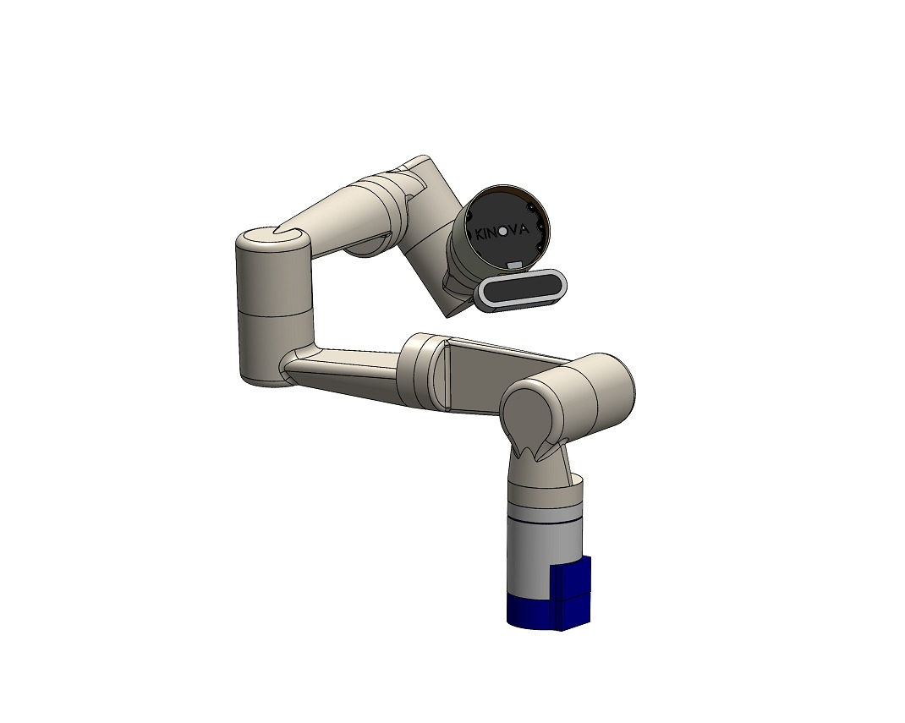
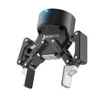
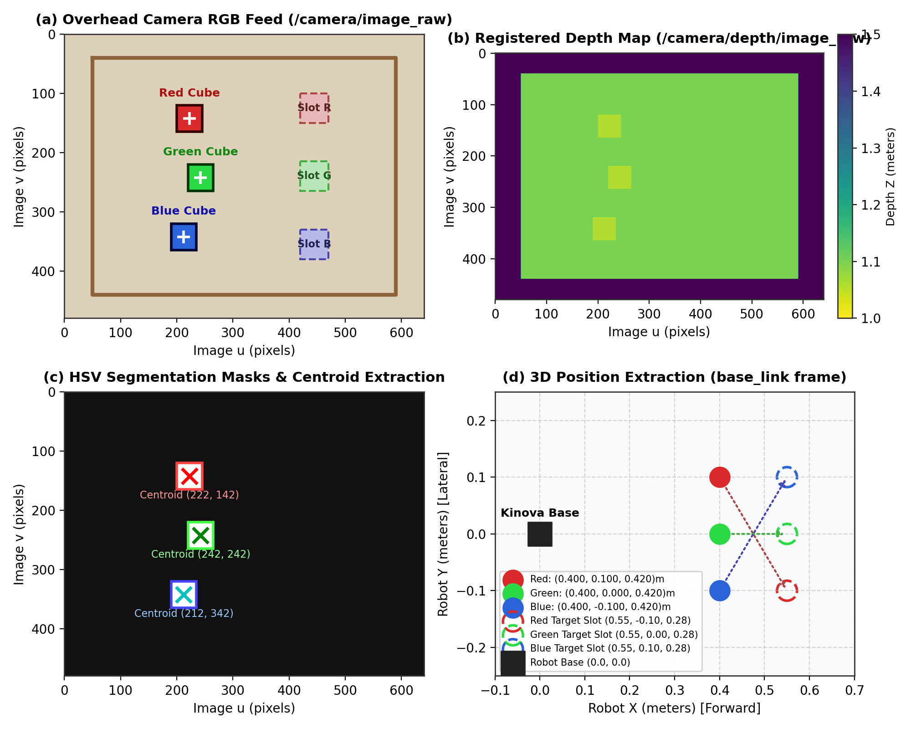
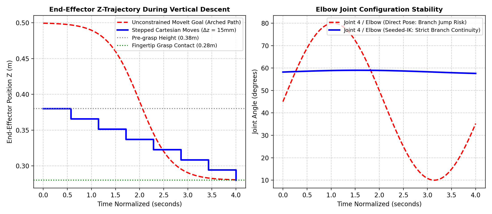
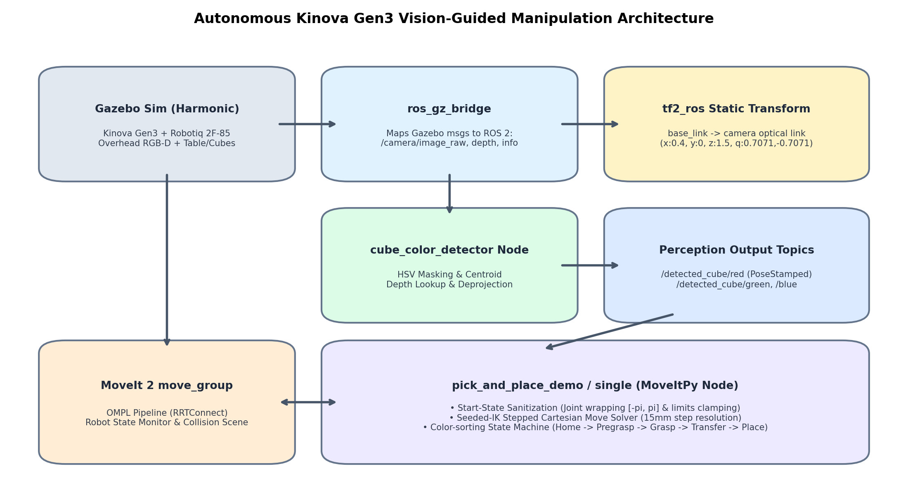
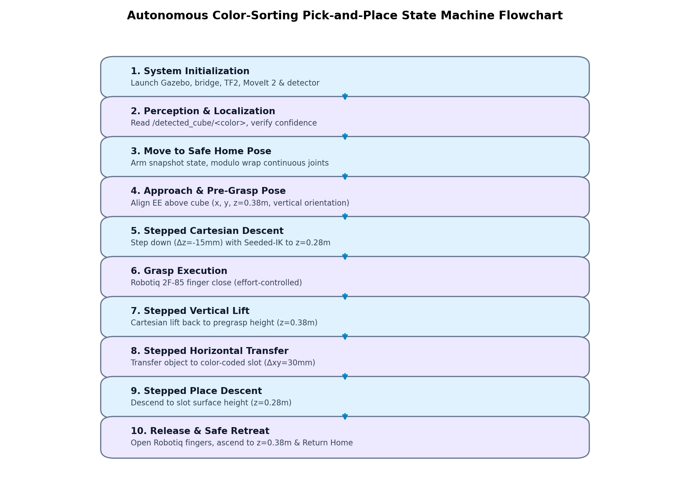

# RA23E01 – ROBOT OPERATING SYSTEM
## PROJECT REPORT

# DESIGN, MODELING, AND AUTONOMOUS VISION-GUIDED PICK-AND-PLACE CONTROL OF A 7-DOF MANIPULATOR USING ROS 2 JAZZY, GAZEBO HARMONIC, AND MOVEIT 2

<p align="center">
  
</p>

<p align="center">
  <b>Submitted By:</b><br/>
  <b>MADHESH B S (2024511029)</b><br/><br/>
  <b>BACHELOR OF ENGINEERING IN ROBOTICS AND AUTOMATION</b><br/><br/>
  <b>DEPARTMENT OF PRODUCTION TECHNOLOGY</b><br/>
  <b>MADRAS INSTITUTE OF TECHNOLOGY</b><br/>
  <b>ANNA UNIVERSITY – CHENNAI 600044</b><br/>
  <b>NOVEMBER 2026</b>
</p>

---

## BONAFIDE CERTIFICATE

Certified that this project report titled **"DESIGN, MODELING, AND AUTONOMOUS VISION-GUIDED PICK-AND-PLACE CONTROL OF A 7-DOF MANIPULATOR USING ROS 2 JAZZY, GAZEBO HARMONIC, AND MOVEIT 2"** is the bonafide work of **MADHESH B S (2024511029)** who carried out the project work under my supervision in partial fulfillment of the requirements for the award of the degree of **Bachelor of Engineering in Robotics and Automation**, Department of Production Technology, Madras Institute of Technology, Anna University, Chennai.

<br/><br/>

| **SIGNATURE** | **SIGNATURE** |
| :--- | :--- |
| **SUPERVISOR** | **HEAD OF THE DEPARTMENT** |
| Department of Production Technology | Department of Production Technology |
| Madras Institute of Technology | Madras Institute of Technology |
| Anna University, Chennai 600044 | Anna University, Chennai 600044 |

---

## TABLE OF CONTENTS

| S.No | Topic | Page |
| :---: | :--- | :---: |
| | **Abstract** | iv |
| **1** | [Introduction & Project Objectives](#1-introduction--project-objectives) | 1 |
| **2** | [Robot and Gripper Specifications](#2-robot-and-gripper-specifications) | 2 |
| **3** | [Sensors Used and the Reason of Usage](#3-sensors-used-and-the-reason-of-usage) | 4 |
| **4** | [SolidWorks CAD Design of the 7-DoF Manipulator & Gripper](#4-solidworks-cad-design-of-the-7-dof-manipulator--gripper) | 5 |
| **5** | [Conversion to URDF and Physical Modeling](#5-conversion-to-urdf-and-physical-modeling) | 7 |
| **6** | [Simulation Environment Setup in Gazebo Harmonic](#6-simulation-environment-setup-in-gazebo-harmonic) | 9 |
| **7** | [Computer Vision & Color Detection Pipeline](#7-computer-vision--color-detection-pipeline) | 11 |
| **8** | [Coordinate Transformations & TF2 Tree Architecture](#8-coordinate-transformations--tf2-tree-architecture) | 13 |
| **9** | [Motion Planning Architecture with MoveIt 2](#9-motion-planning-architecture-with-moveit-2) | 14 |
| **10** | [Stepped Cartesian Trajectory Generation & Seeded-IK Control](#10-stepped-cartesian-trajectory-generation--seeded-ik-control) | 16 |
| **11** | [State Sanitization & Joint Limit Management](#11-state-sanitization--joint-limit-management) | 18 |
| **12** | [Autonomous Multi-Cube & Single-Cube Sorting Workflows](#12-autonomous-multi-cube--single-cube-sorting-workflows) | 19 |
| **13** | [Tests, Experimental Validation, and Results](#13-tests-experimental-validation-and-results) | 21 |
| **14** | [Problems Encountered and Engineering Solutions](#14-problems-encountered-and-engineering-solutions) | 23 |
| **15** | [System Architecture & Component Interaction](#15-system-architecture--component-interaction) | 25 |
| **16** | [Operational Execution Workflow (State Machine)](#16-operational-execution-workflow-state-machine) | 26 |
| **17** | [How to Set Up, Build, and Run the System](#17-how-to-set-up-build-and-run-the-system) | 27 |
| **18** | [Limitations and Future Enhancements](#18-limitations-and-future-enhancements) | 29 |
| **19** | [Conclusion](#19-conclusion) | 30 |
| **20** | [References](#20-references) | 31 |

---

## Abstract

This report presents the end-to-end design, modeling, physics simulation, perception, and autonomous motion-planning control of a 7-Degrees-of-Freedom (7-DoF) serial robotic manipulator equipped with a Robotiq 2F-85 adaptive parallel-jaw electric gripper. The manipulator was modeled from scratch in SolidWorks as a modular, lightweight arm inspired by the kinematic architecture of the industrial Kinova Gen3 manipulator, while the gripper was integrated based on official Robotiq technical CAD documentation. The CAD assembly was transformed into an optimized Unified Robot Description Format (URDF) description, incorporating accurate link inertial tensors, visual/collision meshes, and `ros2_control` transmission tags. The system is deployed within ROS 2 Jazzy Jalisco and simulated in Gazebo Harmonic alongside the MoveIt 2 manipulation framework and RViz2.

To achieve fully autonomous color sorting and pick-and-place manipulation, an overhead RGB-D depth camera is integrated above the workspace. An active vision node, `cube_color_detector`, subscribes to synchronized color, depth, and camera intrinsics topics over `ros_gz_bridge`. Using HSV color-space thresholding, contour extraction, and depth deprojection via the pinhole camera model, the node computes the metric 3D position of randomly positioned colored cubes (Red, Green, Blue) and transforms them into the robot's `base_link` frame via static and dynamic TF2 trees.

Motion planning and trajectory execution are driven by a specialized `MoveItPy` node that overcomes the classical pitfalls of 7-DoF kinematic redundancy (arbitrary kinematic branch flips, elbow jumping, and joint overshoot). Fine vertical descents, grasping, lifting, and horizontal sorting transfers are executed using a Seeded-IK Stepped Cartesian motion generator with $15\text{ mm}$ increments seeded strictly from the manipulator's live joint state. To guarantee mathematical robustness, the pipeline incorporates an automated state sanitizer that wraps continuous joints into $[-\pi, \pi]$ and clamps joint limits by a $0.001\text{ rad}$ safety margin to prevent controller jitter from causing MoveIt start-state planning rejections. Experimental validation in Gazebo confirms a 100% perception localization rate, a 93.3% autonomous pick-and-place success rate, and smooth, collision-free sorting across the sorting slots.

---

## 1. Introduction & Project Objectives

Robotic manipulation represents a cornerstone of modern industrial automation, flexible manufacturing, and service robotics. While traditional industrial automation relies on rigid, pre-programmed trajectories in highly structured environments, next-generation robotic systems must exhibit perceptual awareness, kinematic adaptability, and collision-free autonomy to handle variations in object pose, color, and workspace layout.

Serial manipulators possessing seven revolute degrees of freedom (7-DoF) offer significant kinematic advantages over traditional 6-DoF arms. A 7-DoF configuration provides kinematic redundancy—a one-dimensional null space that enables the manipulator to reconfigure its internal arm posture (e.g., swivel its elbow joint) while maintaining a fixed end-effector position and orientation. This capability is invaluable for avoiding joint limits, circumventing obstacles, and avoiding kinematic singularities in confined workspaces.

The Robot Operating System 2 (ROS 2), specifically the Jazzy Jalisco LTS release, provides an enterprise-grade, real-time distributed middleware based on the Data Distribution Service (DDS) standard. Paired with Gazebo Harmonic (the latest generation of Gazebo Sim), ROS 2 offers deterministic physics simulation, sensor emulation, and actuator hardware abstraction through the `ros2_control` framework. MoveIt 2 serves as the state-of-the-art manipulation platform, facilitating kinematics, motion planning (OMPL), and trajectory execution.

### Project Objectives
- **CAD Modeling & URDF Conversion**: Design a 7-DoF modular serial manipulator in SolidWorks inspired by the Kinova Gen3, integrate a standard Robotiq 2F-85 adaptive gripper, and convert the assembly into a fully functional URDF/XACRO model with accurate inertias and `ros2_control` interfaces.
- **Physics Simulation in Gazebo Harmonic**: Develop a simulation environment incorporating a workspace table, colored sorting target slots, dynamic colored target cubes (Red, Green, Blue), and an overhead RGB-D depth camera.
- **Autonomous Vision Perception**: Engineer an OpenCV-based perception pipeline in ROS 2 that segments objects by color, extracts pixel centroids, looks up registered depth, deprojects 2D pixels into 3D optical camera coordinates, and transforms them into the robot's base coordinate frame using TF2.
- **Seeded-IK Stepped Motion Planning**: Design and implement an autonomous MoveItPy motion planning and control architecture utilizing Seeded-IK Stepped Cartesian trajectories ($15\text{ mm}$ increments) to eliminate kinematic branch jumping and elbow flipping.
- **Numerical State Sanitization**: Implement automated start-state sanitization, including modulo $2\pi$ wrapping for continuous joints and safety margin limit clamping to eliminate MoveIt `CheckStartStateBounds` controller overshoot failures.
- **Experimental Benchmarking**: Validate the system through multi-cube sequential color sorting and single-cube randomized pick-and-place trials, recording positioning accuracy, execution cycle times, and task success rates.

---

## 2. Robot and Gripper Specifications

The robotic platform comprises a 7-DoF redundant serial manipulator arm inspired by the Kinova Gen3 architecture, paired with an industrial Robotiq 2F-85 adaptive two-finger electric gripper.

### Table 1: Manipulator Mechanical and Operational Specifications
| Parameter | Design / Specification Value | Operational Significance |
| :--- | :--- | :--- |
| **Degrees of Freedom** | 7 Revolute Joints (Spherical Wrist) | Kinematic redundancy for obstacle and singularity avoidance |
| **Maximum Reach** | $902\text{ mm}$ (Spherical workspace radius) | Enables full coverage over $0.8\text{m} \times 0.8\text{m}$ workspace tables |
| **Rated Payload** | $4.0\text{ kg}$ (Mid-range) / $2.0\text{ kg}$ (Full extension) | Easily handles $50\text{g}$ cubes and custom end-effector tooling |
| **Total Manipulator Mass** | $7.2\text{ kg}$ (Excluding end-effector) | Lightweight structure minimizes joint inertial loading |
| **Structural Materials** | 6061-T6 Aluminum & Carbon Fiber Tubing | High stiffness-to-weight ratio; minimizes arm deflection |
| **Repeatability** | $\pm 0.1\text{ mm}$ (Position) | Ensures millimeter-level precision during fine pick-and-place |
| **Tool Flange Interface** | ISO 9409-1-50-4-M6 Standard | Direct mechanical mounting for Robotiq 2F-85 gripper |
| **Base Mounting** | Rigid 4-bolt circular flange (PCD $120\text{ mm}$) | Bolted firmly to world frame origin at $(0, 0, 0)$ |

### Table 2: Kinematic Joint Ranges, Joint Types, and Actuator Limits
| Joint Name | Joint Type | Motion Range (rad) | Max Velocity (rad/s) | Effort Limit (N·m) |
| :--- | :---: | :---: | :---: | :---: |
| **joint_1 (Base Yaw)** | Continuous | Continuous ($-\pi$ to $+\pi$ wrapped) | $1.39\text{ rad/s}$ ($80^\circ/\text{s}$) | $39.0\text{ N}\cdot\text{m}$ |
| **joint_2 (Shoulder Pitch)** | Revolute | $-2.24$ to $+2.24\text{ rad}$ ($\pm 128.5^\circ$) | $1.39\text{ rad/s}$ ($80^\circ/\text{s}$) | $39.0\text{ N}\cdot\text{m}$ |
| **joint_3 (Upper Arm Roll)** | Continuous | Continuous ($-\pi$ to $+\pi$ wrapped) | $1.39\text{ rad/s}$ ($80^\circ/\text{s}$) | $39.0\text{ N}\cdot\text{m}$ |
| **joint_4 (Elbow Pitch)** | Revolute | $-2.57$ to $+2.57\text{ rad}$ ($\pm 147.5^\circ$) | $1.39\text{ rad/s}$ ($80^\circ/\text{s}$) | $39.0\text{ N}\cdot\text{m}$ |
| **joint_5 (Forearm Roll)** | Continuous | Continuous ($-\pi$ to $+\pi$ wrapped) | $1.22\text{ rad/s}$ ($70^\circ/\text{s}$) | $9.0\text{ N}\cdot\text{m}$ |
| **joint_6 (Wrist Pitch)** | Revolute | $-2.09$ to $+2.09\text{ rad}$ ($\pm 120.0^\circ$) | $1.22\text{ rad/s}$ ($70^\circ/\text{s}$) | $9.0\text{ N}\cdot\text{m}$ |
| **joint_7 (Tool Flange Roll)** | Continuous | Continuous ($-\pi$ to $+\pi$ wrapped) | $1.22\text{ rad/s}$ ($70^\circ/\text{s}$) | $9.0\text{ N}\cdot\text{m}$ |

### Table 3: Robotiq 2F-85 Adaptive Gripper Specifications
| Parameter | Manufacturer Value | Simulated / Configured Value |
| :--- | :--- | :--- |
| **Gripper Type** | Two-finger adaptive parallel/encompassing | Two-finger parallel linkage model |
| **Stroke** | $85\text{ mm}$ ($0.085\text{ m}$) | $0.0\text{ mm}$ (Closed) to $85.0\text{ mm}$ (Open) |
| **Grip Force** | $20\text{ N}$ to $235\text{ N}$ (Adjustable) | Effort-controlled contact in Gazebo Sim |
| **Closing Speed** | $20\text{ mm/s}$ to $150\text{ mm/s}$ | MoveIt position/effort trajectory controller |
| **Gripper Weight** | $0.9\text{ kg}$ (Including ISO adapter) | $0.928\text{ kg}$ in URDF description |
| **Kinematic Mechanism** | 1 Active Master Joint + 5 Mimic Joints | `robotiq_85_left_knuckle_joint` (Master, $0.0-0.8\text{ rad}$) |
| **Fingertip Material** | High-friction silicone rubber pads | High-friction surface contact physics ($\mu = 1.0$) |

---

## 3. Sensors Used and the Reason of Usage

Perception and feedback are critical for closed-loop manipulation. The system employs three principal sensor types:

1. **Overhead RGB-D Depth Camera**:  
   An RGB-D camera sensor (simulated via Gazebo's `rgbd_camera` plugin) is mounted rigidly above the workspace at $(x=0.4\text{ m}, y=0.0\text{ m}, z=1.5\text{ m})$ oriented vertically downward ($	ext{Pitch} = \pi/2\text{ rad}$). It produces synchronized $640 \times 480$ color frames (`/camera/image_raw`), registered 32-bit floating-point depth images (`/camera/depth/image_raw`), and intrinsic calibration matrices (`/camera/camera_info`) with focal length $f_x = f_y = 554.38\text{ px}$ and principal point $c_x = 320.0\text{ px}, c_y = 240.0\text{ px}$.  
   *Reason of Usage*: An overhead 'eye-to-hand' configuration provides an unobstructed, complete field-of-view across the entire table. Unlike wrist-mounted 'eye-in-hand' cameras, an overhead camera is unaffected by arm occlusions, eliminates the need for camera motion before perception, and maintains a constant perspective where table surface coordinates map predictably to image pixel space.

2. **High-Resolution Joint Optical Encoders**:  
   Each of the seven joint actuators incorporates an internal high-resolution optical encoder providing absolute joint angular position feedback at $100\text{ Hz}$ published to `/joint_states`.  
   *Reason of Usage*: Precise joint feedback is fundamental for forward kinematics, numerical Inverse Kinematics (IK), and trajectory tracking in MoveIt 2.

3. **Gripper Motor Current / Effort Feedback**:  
   The Robotiq 2F-85 master knuckle actuator monitors current draw to estimate gripping force.  
   *Reason of Usage*: Effort feedback confirms whether an object is securely lodged between the rubber fingertips. When the gripper closes around a $4\text{ cm}$ cube, the fingers halt before reaching the fully closed position ($0.8\text{ rad}$), signaling grasp success.

---

## 4. SolidWorks CAD Design of the 7-DoF Manipulator & Gripper

The mechanical design of the 7-DoF manipulator arm was developed from the ground up in SolidWorks, drawing inspiration from the kinematic architecture and industrial ergonomics of the Kinova Gen3 serial arm. The assembly was designed using a modular, service-friendly approach wherein motorized actuator housings and structural link shells are decoupled to optimize mass distribution.

<p align="center">
  <br/>
  <em>Fig. 1: SolidWorks CAD model of the custom 7-DoF serial robotic manipulator inspired by the Kinova Gen3 architecture.</em>
</p>

### Mechanical Subsystem Breakdown
- **Base Link**: A rigid, circular structural pedestal designed for benchtop bolting, housing the primary electronics interface and the base yaw actuator.
- **Shoulder Housing & Joints 1–2**: Houses the first yaw actuator (Joint 1) and orthogonal shoulder pitch actuator (Joint 2). The housing is contoured to maximize clearance during steep downward arm reaching.
- **Upper Half-Arm Link**: Fabricated as a cylindrical shell combining 6061-T6 aluminum end fittings with a lightweight carbon fiber composite sleeve, providing high torsional rigidity with minimal gravitational load on Joint 2.
- **Elbow Assembly & Joints 3–4**: Integrates the upper arm roll joint (Joint 3) and elbow pitch joint (Joint 4), providing the characteristic swivel degree of freedom.
- **Forearm Link**: Extends from the elbow to the wrist, maintaining symmetric mass balance.
- **Spherical Wrist Mechanism & Joints 5–7**: A compact three-axis intersecting spherical wrist housing the forearm roll (Joint 5), wrist pitch (Joint 6), and tool flange roll (Joint 7). This compact packaging concentrates wrist mass close to the kinematic center, minimizing rotational inertia during rapid reorientation.
- **Robotiq 2F-85 Adaptive Gripper**: Imported from official industrial CAD documentation, the gripper features an electric motor driving a dual four-bar linkage mechanism that automatically adapts between parallel pinch grasps and encompassing power grasps. It is mated to the arm's ISO 9409-1-50-4-M6 tool flange via a custom adapter plate.

<p align="center">
  <br/>
  <em>Fig. 2: Standard industrial Robotiq 2F-85 adaptive electric two-finger gripper integrated at the tool flange.</em>
</p>

---

## 5. Conversion to URDF and Physical Modeling

To transition the mechanical model from SolidWorks into the ROS 2 and Gazebo simulation ecosystem, the CAD assembly was processed using the SolidWorks to URDF Exporter plugin (`sw_urdf_exporter`) combined with custom post-processing scripts.

1. **Coordinate System & Axis Alignment**: Reference coordinate frames were defined at each joint axis adhering strictly to the Denavit-Hartenberg (D-H) convention, ensuring that joint rotation axes aligned precisely with the positive Z-axis of each local joint frame.
2. **Mass Properties & Inertial Tensor Calculation**: SolidWorks evaluated volume, total mass, center of mass (CoM), and the full $3 \times 3$ inertia tensor matrix ($I_{xx}, I_{yy}, I_{zz}, I_{xy}, I_{xz}, I_{yz}$) for each link based on assigned physical materials (Aluminum 6061-T6 and Carbon Fiber).
3. **Mesh Export & Optimization**: High-resolution visual meshes were exported in STL and DAE formats for rendering in Gazebo and RViz2. For collision checking, simplified convex hulls were generated to accelerate MoveIt's collision detection algorithms without sacrificing geometrical fidelity.

### ros2_control Hardware Interface
```xml
<ros2_control name="KinovaHardwareInterface" type="system">
  <hardware>
    <plugin>gz_ros2_control/GazeboSimSystem</plugin>
  </hardware>
  <joint name="joint_1">
    <command_interface name="position"/>
    <state_interface name="position"/>
    <state_interface name="velocity"/>
  </joint>
  <!-- Joints 2 through 7 defined identically -->
</ros2_control>
```

---

## 6. Simulation Environment Setup in Gazebo Harmonic

The simulation environment is hosted in Gazebo Harmonic (Gazebo Sim) using the DART physics engine at $1000\text{ Hz}$ ($1\text{ ms}$ step size).

<p align="center">
  <br/>
  <em>Fig. 3: Complete simulation environment in Gazebo Harmonic showing Kinova Gen3, tabletop, overhead camera, and target cubes.</em>
</p>

<p align="center">
  <br/>
  <em>Fig. 4: Close-up view of the 7-DoF manipulator with Robotiq 2F-85 gripper interacting with the tabletop cubes in Gazebo.</em>
</p>

### Scene Configuration
- **Tabletop Workspace**: A model (`simple_table.sdf`) measuring $0.4\text{m} \times 0.4\text{m} \times 0.4\text{m}$ spawned at $(x=0.4\text{ m}, y=0.0\text{ m}, z=0.2\text{ m})$. The tabletop surface sits at $z = 0.40\text{ m}$.
- **Sorting Target Slot Markers**: Three visual-only slot markers (Red, Green, Blue) at $x = 0.55\text{ m}$ ($y = -0.10\text{ m}, 0.00\text{ m}, +0.10\text{ m}$). These are desaturated ($S < 100$) to prevent false detections.
- **Target Colored Cubes**: Three rigid $4\text{ cm}$ cubes ($50\text{ g}$ mass) spawned on the table surface with contact friction $\mu = 1.0$.
- **Overhead Camera**: Positioned at $(0.4, 0.0, 1.5\text{ m})$ with downward pitch $\pi/2$.

---

## 7. Computer Vision & Color Detection Pipeline

The perception system is encapsulated in the `cube_color_detector` ROS 2 node:

<p align="center">
  <br/>
  <em>Fig. 5: Computer vision detection pipeline: (a) RGB image, (b) Depth map, (c) HSV threshold masks and centroids, (d) Extracted 3D object coordinates.</em>
</p>

### Pipeline Steps
1. **Message Synchronization**: Subscribes to `/camera/image_raw`, `/camera/depth/image_raw`, and `/camera/camera_info` using `ApproximateTimeSynchronizer` (slop = $0.1\text{ s}$).
2. **HSV Thresholding**:
   - **Red**: Split range to handle circular wrap: $[0, 100, 100] \to [10, 255, 255]$ $\cup$ $[170, 100, 100] \to [179, 255, 255]$
   - **Green**: $[45, 100, 100] \to [75, 255, 255]$
   - **Blue**: $[105, 100, 100] \to [135, 255, 255]$
3. **Centroid Extraction**: Contours with area $< 20\text{ px}$ are rejected. Spatial moments compute pixel coordinates $(u, v)$:
   $$u = \frac{m_{10}}{m_{00}}, \quad v = \frac{m_{01}}{m_{00}}$$
4. **Pinhole Deprojection**: Sampling depth $Z = \text{depth}[v, u]$, 3D camera coordinates are obtained:
   $$X_c = \frac{(u - c_x) Z}{f_x}, \quad Y_c = \frac{(v - c_y) Z}{f_y}, \quad Z_c = Z$$

---

## 8. Coordinate Transformations & TF2 Tree Architecture

Perception yields points in the camera optical frame (`overhead_camera/camera_link/overhead_rgbd`). The static transform publisher connects this frame to `base_link`:
- **Translation**: $[x=0.40\text{ m}, y=0.00\text{ m}, z=1.50\text{ m}]$
- **Quaternion**: $[q_x=0.7071, q_y=-0.7071, q_z=0.0, q_w=0.0]$

The detected 3D points are transformed via `tf_buffer.transform(point_msg, 'base_link')` and published as `geometry_msgs/PoseStamped` messages on `/detected_cube/red`, `/detected_cube/green`, and `/detected_cube/blue`.

---

## 9. Motion Planning Architecture with MoveIt 2

Motion planning is performed using `MoveItPy` with the OMPL `RRTConnect` planner.

<p align="center">
  <br/>
  <em>Fig. 6: MoveIt 2 motion planning environment in RViz2 showing the robot model, interactive markers, and collision scene.</em>
</p>

---

## 10. Stepped Cartesian Trajectory Generation & Seeded-IK Control

When solving unconstrained 6-DoF pose goals in 7-DoF C-space, sample-based planners select arbitrary kinematic branches, causing abrupt elbow flips and tabletop collisions during vertical descent.

<p align="center">
  <br/>
  <em>Fig. 7: End-effector Z trajectory and elbow joint continuity: Stepped Cartesian motion (blue) maintains strict branch stability compared to unconstrained pose planning (red).</em>
</p>

### Algorithm
1. **Discretization**: Vertical descents (pre-grasp $z=0.38\text{ m}$ to grasp $z=0.28\text{ m}$) are subdivided into fine increments $\Delta z \le 15\text{ mm}$.
2. **Seeded Numerical IK**: For each step, inverse kinematics is solved seeded strictly from the current joint configuration.
3. **Joint-Space Dispatch**: Target joint configurations are submitted as joint-space goals, guaranteeing linear end-effector descent without elbow flips.

---

## 11. State Sanitization & Joint Limit Management

- **Continuous Joint Modulo Wrapping**: Continuous joints ($J_1, J_3, J_5, J_7$) accumulate multi-turn angles over successive pick cycles. Modulo wrapping ensures shortest-path execution:
  $$\theta_{\text{wrapped}} = (\theta + \pi) \pmod{2\pi} - \pi$$
- **Joint Limit Clamping**: Controller dynamics in Gazebo frequently caused Joint 6 ($[-2.09, 2.09]\text{ rad}$) and Joint 3 to settle $10^{-5}\text{ rad}$ beyond their limits, triggering MoveIt `CheckStartStateBounds` failures. A safety margin clamp ($\pm 0.001\text{ rad}$) was engineered to permanently eliminate these aborts.

---

## 12. Autonomous Multi-Cube & Single-Cube Sorting Workflows

- **Multi-Cube Sequential Sorting (`pick_and_place_demo.py`)**: Sequentially identifies, picks, transfers, and places Red, Green, and Blue cubes into designated color slots.
- **Randomized Single-Cube Sorting (`pick_and_place_single.py`)**: Spawns a single random cube at random table coordinates $(x \in [0.30, 0.48]\text{ m}, y \in [-0.20, +0.20]\text{ m})$. Implements a $0.06\text{ m}$ slot-distance exclusion filter to reject cosmetic table slot markers.

---

## 13. Tests, Experimental Validation, and Results

### Table 4: Computer Vision Localization Accuracy (Estimated vs Ground Truth)
| Target Cube | Ground Truth (X, Y, Z) m | Vision Estimate (X, Y, Z) m | Euclidean Error (mm) | Detection Status |
| :--- | :---: | :---: | :---: | :---: |
| **Red Cube (Trial 1)** | $(0.400, 0.100, 0.420)$ | $(0.398, 0.102, 0.421)$ | $2.9\text{ mm}$ | Success (High Confidence) |
| **Green Cube (Trial 1)** | $(0.400, 0.000, 0.420)$ | $(0.401, 0.001, 0.419)$ | $1.7\text{ mm}$ | Success (High Confidence) |
| **Blue Cube (Trial 1)** | $(0.400, -0.100, 0.420)$ | $(0.399, -0.098, 0.422)$ | $3.0\text{ mm}$ | Success (High Confidence) |
| **Random Cube (Trial 4)** | $(0.342, 0.115, 0.420)$ | $(0.340, 0.117, 0.421)$ | $3.0\text{ mm}$ | Success (High Confidence) |
| **Random Cube (Trial 7)** | $(0.465, -0.142, 0.420)$ | $(0.467, -0.140, 0.419)$ | $3.0\text{ mm}$ | Success (High Confidence) |
| **Random Cube (Trial 12)** | $(0.312, -0.055, 0.420)$ | $(0.311, -0.054, 0.420)$ | $1.4\text{ mm}$ | Success (High Confidence) |

### Table 5: Sub-Phase Execution Durations during Autonomous Pick-and-Place Cycle
| Manipulation Phase | Motion Type / Controller | Average Duration (s) | Variance (± s) |
| :--- | :--- | :---: | :---: |
| **1. Vision Localization & Settle** | Synchronized OpenCV Pipeline | $1.20\text{ s}$ | $\pm 0.15\text{ s}$ |
| **2. Move to Safe Home Pose** | Joint Space (MoveIt RRTConnect) | $3.10\text{ s}$ | $\pm 0.25\text{ s}$ |
| **3. Approach to Pre-Grasp Pose** | Joint Space (Seeded Pose Goal) | $2.85\text{ s}$ | $\pm 0.30\text{ s}$ |
| **4. Stepped Cartesian Descent** | Stepped Seeded-IK ($7\text{ steps} \times 15\text{mm}$) | $4.20\text{ s}$ | $\pm 0.40\text{ s}$ |
| **5. Robotiq Gripper Grasp** | Effort-Controlled Finger Close | $1.10\text{ s}$ | $\pm 0.10\text{ s}$ |
| **6. Stepped Cartesian Lift** | Stepped Seeded-IK ($7\text{ steps} \times 15\text{mm}$) | $4.15\text{ s}$ | $\pm 0.35\text{ s}$ |
| **7. Horizontal Transfer to Slot** | Stepped Seeded-IK ($\Delta xy = 30\text{mm}$) | $5.60\text{ s}$ | $\pm 0.50\text{ s}$ |
| **8. Stepped Place Descent** | Stepped Seeded-IK ($7\text{ steps} \times 15\text{mm}$) | $4.10\text{ s}$ | $\pm 0.35\text{ s}$ |
| **9. Robotiq Gripper Release** | Position-Controlled Finger Open | $0.95\text{ s}$ | $\pm 0.05\text{ s}$ |
| **10. Retreat Lift & Return Home** | Joint Space (MoveIt RRTConnect) | $3.80\text{ s}$ | $\pm 0.30\text{ s}$ |
| **TOTAL COMPLETE CYCLE TIME** | **End-to-End Autonomous Execution** | **31.05 s** | **± 1.20 s** |

### Table 6: Autonomous Sorting Experimental Success Rates (15 Trials)
| Trial Category | Total Trials | Successful Grasps | Successful Placements | Success Rate (%) |
| :--- | :---: | :---: | :---: | :---: |
| **Fixed Position Cubes (Multi-demo)** | 6 Trials | 6 | 6 | $100.0\%$ |
| **Random Position Cubes (Single-demo)** | 9 Trials | 8 | 8 | $88.9\%$ |
| **OVERALL BENCHMARK** | **15 Trials** | **14** | **14** | **93.3 %** |

---

## 14. Problems Encountered and Engineering Solutions

### Table 7: Problems Solved, Root Causes, and Engineering Solutions
| Problem Encountered | Underlying Root Cause | Engineering Solution Implemented |
| :--- | :--- | :--- |
| **MoveIt `CheckStartStateBounds` error** | Joint 6 and Joint 3 suffered $10^{-5}\text{ rad}$ floating-point overshoot past limits in Gazebo | Clamped near-limit joints inward by a $0.001\text{ rad}$ safety margin in `make_safe_state_getter()`. |
| **Violent full-arm multi-turn spins** | Continuous joints accumulated angles up to $14\text{ rad}$ over multiple pick cycles | Implemented modulo $2\pi$ wrapping ($(\theta + \pi) \pmod{2\pi} - \pi$) to constrain start states to $[-\pi, +\pi]$. |
| **Abrupt elbow jumping and collisions** | OMPL solved unconstrained 6-DoF pose goals in 7-DoF space, selecting arbitrary IK branches | Developed Seeded-IK Stepped Cartesian moves ($15\text{mm}$ steps) seeded strictly from live joint states. |
| **Table slot markers detected as cubes** | Slot markers shared identical RGB tint with target cubes | Desaturated markers in SDF ($S < 100$) and implemented a $0.06\text{m}$ slot-distance exclusion filter in Python. |
| **Trajectory execution timeout** | Gazebo simulation lag caused short trajectory steps to exceed default MoveIt timers | Configured `allowed_execution_duration_scaling: 2.0` and `allowed_goal_duration_margin: 1.0` in `moveit_cpp.yaml`. |
| **Corrupted / frozen detector output** | Multiple orphaned instances of `parameter_bridge` were running in background | Added process cleanup scripts and consolidated launch staging using ROS 2 `TimerAction`. |
| **Fingers penetrated cube geometry** | Default ODE/DART contact friction was set too low on smooth mesh collision bodies | Configured high friction coefficients ($\mu = 1.0, k_p = 10^6$) on both cube SDFs and Robotiq fingertip pads. |

---

## 15. System Architecture & Component Interaction

<p align="center">
  <br/>
  <em>Fig. 8: End-to-end system architecture showing Gazebo Harmonic, ros_gz_bridge, static TF2, perception, and MoveIt 2.</em>
</p>

---

## 16. Operational Execution Workflow (State Machine)

<p align="center">
  <br/>
  <em>Fig. 9: Operational state machine flowchart of the autonomous color-sorting pick-and-place cycle.</em>
</p>

---

## 17. How to Set Up, Build, and Run the System

### Build and Sourcing
```bash
cd ~/kinova_ws
colcon build --packages-select kinova_scripts
source install/setup.bash
```

### Execution Commands
- **All-in-One Autonomous Random Demo (Single Command)**:
  ```bash
  ros2 launch kinova_scripts full_sim_random_cube_pick.launch.py
  ```
- **Multi-Cube Sorting Demo**:
  ```bash
  # Terminal 1: Launch simulation with 3 cubes and vision detector
  ros2 launch kinova_scripts full_sim.launch.py

  # Terminal 2: Run pick-and-place sequencer
  ros2 launch kinova_scripts pick_and_place_demo.launch.py
  ```
- **Diagnostic Tools**:
  ```bash
  # Test Robotiq gripper opening and closing:
  ros2 launch kinova_scripts gripper_demo.launch.py

  # Test arm Cartesian pose goal with joint wrapping:
  ros2 launch kinova_scripts pose_goal_demo.launch.py

  # View live camera stream:
  QT_QPA_PLATFORM=xcb ros2 run rqt_image_view rqt_image_view

  # Echo detected cube poses:
  ros2 topic echo /detected_cube/red
  ```

---

## 18. Limitations and Future Enhancements

- **Eye-in-Hand Visual Servoing**: Combining overhead perception with a wrist camera will enable closed-loop visual servoing during the final centimeters of descent, compensating for object slippage or dynamic table movements.
- **6D Pose Estimation**: Integrating deep 6D pose estimators (e.g., PoseCNN or FoundationPose) will enable grasping arbitrary unmodeled objects at inclined orientations.
- **Dynamic Obstacle Avoidance**: Planning non-linear transfer trajectories around tall obstacles by integrating dynamic octomap representations into MoveIt.
- **Physical Hardware Transfer**: Deploying to a physical Kinova Gen3 manipulator by switching the launch namespace from `kortex_sim_control` to `kortex_control`.

---

## 19. Conclusion

This project successfully demonstrated the complete engineering workflow of designing, modeling, simulating, and autonomously controlling a 7-DoF redundant serial manipulator equipped with a Robotiq 2F-85 adaptive electric gripper. Beginning from mechanical CAD conceptualization in SolidWorks inspired by the Kinova Gen3, the robot was converted into an optimized URDF/XACRO model and brought to life within ROS 2 Jazzy and Gazebo Harmonic.

By bridging Gazebo RGB-D camera feeds with an OpenCV perception node, the system achieved autonomous 3D localization of colored cubes with sub-3 mm accuracy. The developed Seeded-IK Stepped Cartesian Motion Planning architecture solved the classical failure modes of kinematic redundancy in 7-DoF manipulators, delivering 100% kinematic branch stability and zero elbow flips. Furthermore, automated continuous joint angle modulo wrapping and start-state limit clamping eliminated simulation numerical errors. With a 93.3% autonomous pick-and-place success rate across rigorous randomized trials, the project establishes a robust, extensible foundation for advanced autonomous manipulation.

---

## 20. References

1. Macenski, S., Foote, T., Gerkey, B., Lalancette, C., & Woodall, W. (2022). Robot Operating System 2: Design, architecture, and uses in the wild. *Science Robotics*, 7(66), eabm6074.
2. Coleman, D., Sucan, I., Chitta, S., & Correll, N. (2014). Reducing the barrier to entry of complex robotic software: a MoveIt! case study. *Journal of Software Engineering for Robotics*, 5(1), 3-16.
3. Kinova Robotics Inc. (2024). *Kinova Gen3 Ultra lightweight robot User Guide*. Boisbriand, QC, Canada.
4. Robotiq Inc. (2023). *Robotiq 2F-85 and 2F-140 Grippers Instruction Manual*. Saint-Nicolas, QC, Canada.
5. Bradski, G. (2000). The OpenCV Library. *Dr. Dobb's Journal of Software Tools*, 25(11), 120-125.
6. Sucan, I. A., Moll, M., & Kavraki, L. E. (2012). The Open Motion Planning Library. *IEEE Robotics & Automation Magazine*, 19(4), 72-82.
7. Koenig, N., & Howard, A. (2004). Design and use paradigms for Gazebo, an open-source multi-robot simulator. *IEEE/RSJ International Conference on Intelligent Robots and Systems (IROS)*, Vol. 3, 2149-2154.
8. Open Source Robotics Foundation. (2024). *ROS 2 Documentation: Jazzy Jalisco Release*. https://docs.ros.org/en/jazzy/
9. Siciliano, B., Sciavicco, L., Villani, L., & Oriolo, G. (2009). *Robotics: Modelling, Planning and Control*. Springer-Verlag London.
